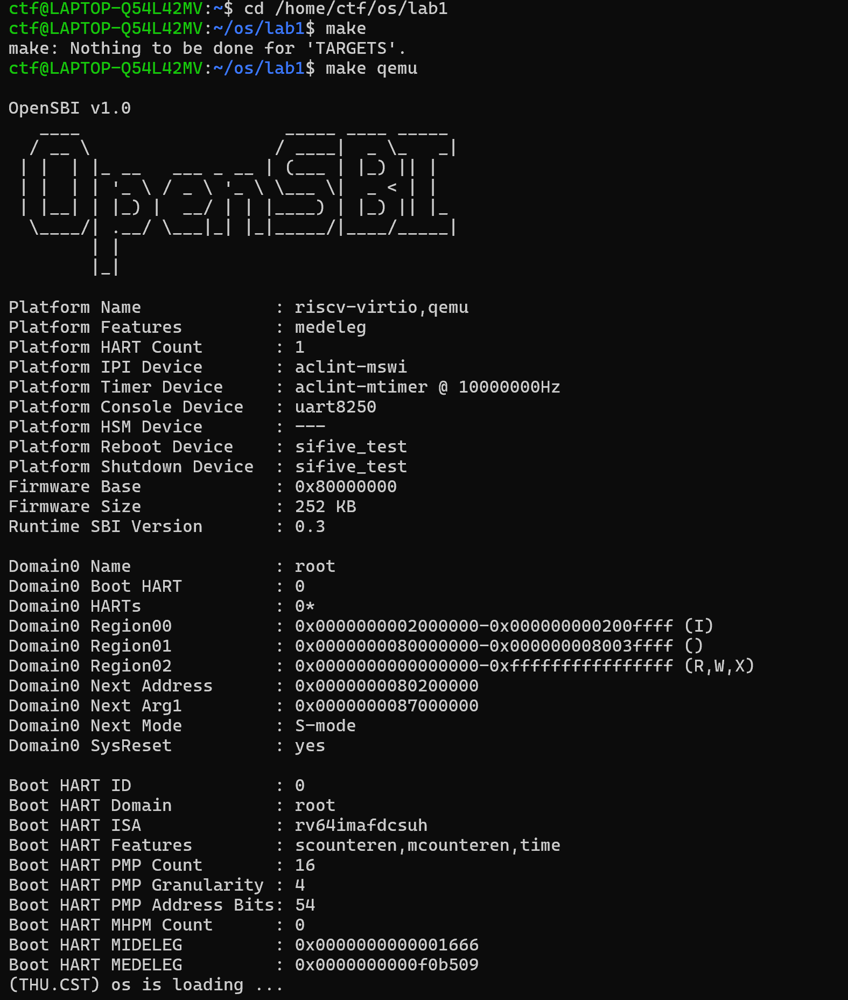
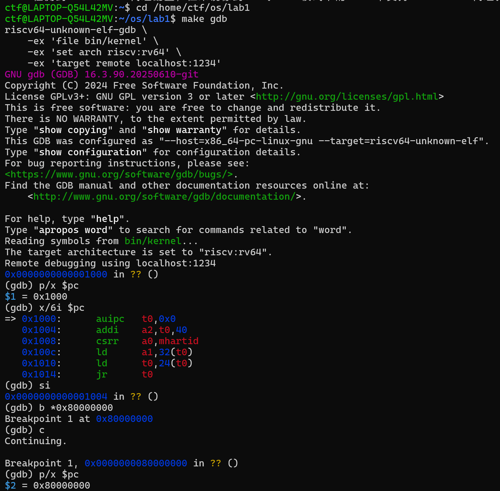
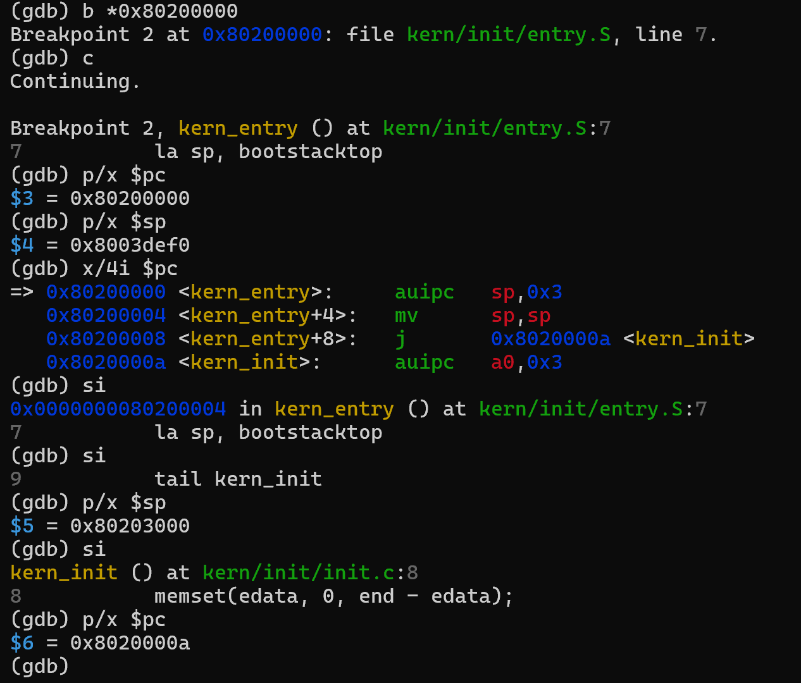
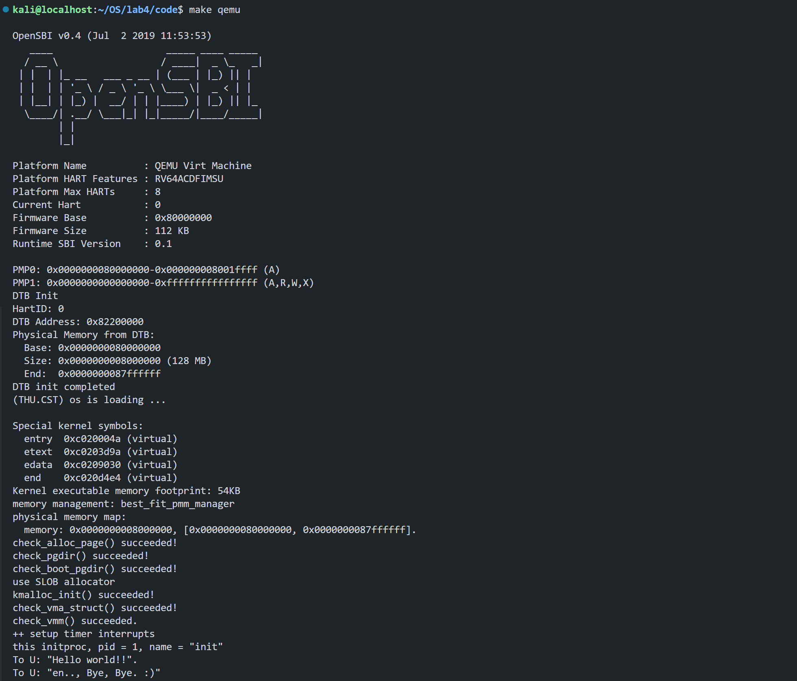
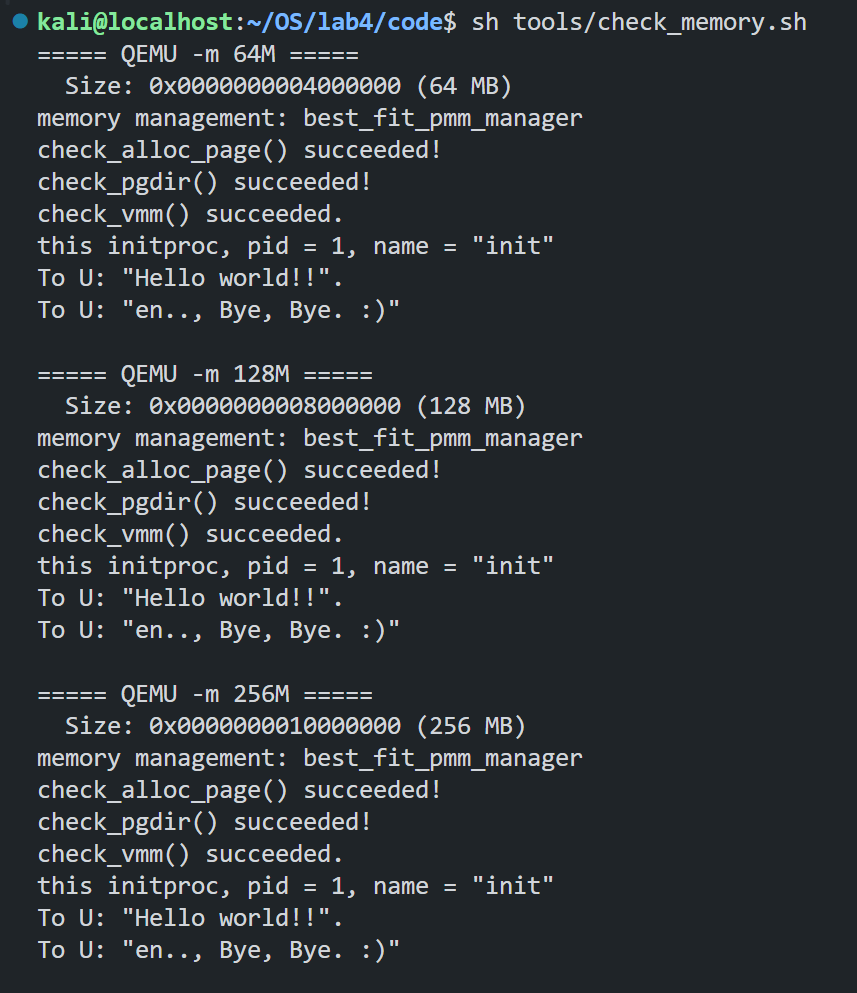
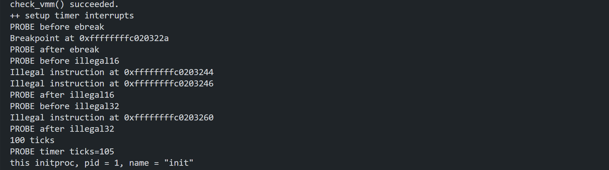

# 操作系统实验报告

## 实验基本信息

<<<<<<< Updated upstream
| 项目       | 内容                                 |
| -------- | ---------------------------------- |
| **实验名称** | Lab 1：比麻雀更小的麻雀（最小可执行内核）            |
| **小组成员** | 2414132-国轩、2411963-孟子玉、2411185-韩东儒 |
| **完成日期** | 2026-09-29                         |

### 小组分工

| 成员          | 实验任务                         | 报告任务                |
| ----------- | ---------------------------- | ------------------- |
| 2414132-国轩  | 梳理启动流程，完成练习 1，统筹实验与结果核对      | 实验目的、整体逻辑、练习 1、全文整合 |
| 2411963-孟子玉 | 完成练习 2，使用 GDB 观察复位至内核入口的执行过程 | 练习 2 及调试记录          |
| 2411185-韩东儒 | 核对编译环境，运行 QEMU 并整理测试结果       | 实验环境、测试与验证、实验总结     |
=======
| 项目 | 内容 |
| --- | --- |
| **实验名称** | Lab 4：进程管理 |
| **小组成员** | 2414132-国轩、2411963-孟子玉、2411185-韩东儒 |
| **完成日期** | 2026-11-16 |

### 小组分工

| 成员 | 实验任务 | 报告任务 |
| --- | --- | --- |
| 2414132-国轩 | 实验二页初始化与 Best-Fit 迁移、`page_insert/page_remove`、Trap 入口与上下文恢复、代码整合 | 实验目的、整体逻辑、物理内存与页表映射、Trap 入口、Challenge 2、全文整合 |
| 2411963-孟子玉 | 进程创建与初始化、中断与异常处理 | 进程管理、中断异常处理、提示词问题分析 |
| 2411185-韩东儒 | 调度与上下文切换、补充测试与运行记录 | 实验环境、调度切换、测试与验证、Challenge 1 |

实验总结由三人共同讨论，国轩负责汇总，孟子玉、韩东儒分别核对进程/中断和测试部分。

### 实验文件组织

本实验交付目录为 `lab4`，按提交要求组织为以下两个文件夹：

```text
lab4/
├── code/                    实验源码、Makefile、工具与运行日志
│   └── evidence/            构建、启动、评分与 Trap 探针原始日志
└── report/
    ├── report.md            实验报告
    ├── prompt.md            本实验提示词汇总
    └── images/              报告引用的测试截图
```

下文终端命令均在 `code/` 中执行，日志保存在 `code/evidence/`。
>>>>>>> Stashed changes

-----

## 一、实验目的

<<<<<<< Updated upstream
1.  理解 RISC-V 最小可执行内核从复位、固件启动到执行内核入口的过程。
2.  理解链接脚本如何确定内核的内存布局和入口地址，以及交叉编译如何生成 ELF 文件和内核镜像。
3.  理解内核入口设置栈、初始化运行环境的作用，并认识通过 OpenSBI 服务实现格式化输出的调用链。
4.  掌握使用 QEMU 运行内核、使用 GDB 观察启动过程的基本方法。
=======
1. 理解虚拟内存管理的基本结构，掌握页表项建立、撤销、引用计数和 TLB 失效之间的关系。
2. 理解进程控制块 `proc_struct` 的字段含义，掌握内核线程的创建、登记和首次运行过程。
3. 理解 `idleproc` 与 `initproc` 的区别，掌握 `kernel_thread`、`do_fork`、`copy_thread` 的协作关系。
4. 理解 FIFO/Round-Robin 调度的选择过程，以及 `proc_run`、`switch_to` 完成上下文切换的底层机制。
5. 通过 QEMU 正常启动、官方评分、多内存配置以及 Trap/关机补充测试，验证地址空间、进程创建、调度与上下文恢复的正确性。
>>>>>>> Stashed changes

-----

## 二、实验环境

<<<<<<< Updated upstream
实际验证所用环境为 Ubuntu 22.04.5 LTS（WSL2，`x86_64`）、`riscv64-unknown-elf-gcc` 15.1.0、QEMU 7.0.0、OpenSBI 1.0 和 RISC-V GDB 16.3.90。实验使用 `lab1` 源码目录中的 Makefile、链接脚本和内核代码。

| 成员          | AI 编程工具            | 底层模型              | 备注                                |
| ----------- | ------------------ | ----------------- | --------------------------------- |
| 2414132-国轩  | Codex（VS Code插件）   | GPT-6             | 用于阅读代码、核对启动参数和辅助整理实验记录            |
| 2411963-孟子玉 | Claude（VS Code 插件） | DeepSeek-V4-Flash | 辅助理解 RISC-V 启动过程，整理 GDB 调试步骤与观察结果 |
| 2411185-韩东儒 | DeepSeek Harness | DeepSeek-V4-Flash | 辅助检查 QEMU 运行结果，整理测试截图与实验总结 |
=======
实际验证环境为 Ubuntu 22.04.5 LTS（WSL2，`x86_64`）、`riscv64-unknown-elf-gcc` 10.2.0、QEMU 4.1.1、OpenSBI v0.4 和 RISC-V GDB 10.1。QEMU 使用 `virt` 机器，默认 128 MiB 内存，单 hart。

| 项目 | 本次使用情况 |
| --- | --- |
| 实验源码 | `lab4` 提供的框架，最终位于 `code/` |
| 编译与链接 | 原工程 Makefile、RISC-V 交叉工具链与链接脚本 |
| 模拟器 | `/opt/qemu-4.1.1/bin/qemu-system-riscv64`，版本 4.1.1 |
| 固件 | QEMU 配套 OpenSBI v0.4，使用 `-bios default` |
| 调试工具 | `riscv64-unknown-elf-gdb` 10.1、宿主 GDB 12.1 |
| 验证方式 | 正常启动、`make grade`、多内存配置、临时 Trap 探针 |

| 成员 | AI 编程工具 | 底层模型 | 备注 |
| --- | --- | --- | --- |
| 2414132-国轩 | Codex（VS Code 插件） | GPT-6 | 辅助梳理页表映射与 Trap 恢复，核对实现并整合报告 |
| 2411963-孟子玉 | Claude（VS Code 插件） | DeepSeek-V4-Flash | 辅助完成进程创建、中断异常处理与问题分析 |
| 2411185-韩东儒 | DeepSeek Harness | DeepSeek-V4-Flash | 辅助完成调度、上下文切换、补充测试与运行记录 |
>>>>>>> Stashed changes

-----

## 三、实验整体逻辑分析

### 3.1 本章节的逻辑主线

<<<<<<< Updated upstream
这次实验主要想弄清楚：一个最小内核是怎样启动并打印出第一行信息的。虽然它还没有进程、文件系统等功能，但启动前仍要确定镜像放在哪里、CPU 从哪里进入内核，以及内核如何输出文字。

我们观察到的启动顺序是：CPU 从 `0x1000` 的复位代码开始，进入 `0x80000000` 处的 OpenSBI，再到 `0x80200000` 处的内核入口。入口代码先设置内核栈，然后跳到 `kern_init`；`kern_init` 处理未初始化数据区、打印信息，最后进入死循环。当前使用的 `-kernel` 参数会让 QEMU 在启动前放好内核镜像，OpenSBI 再把控制权交给内核。

### 3.2 启动过程中的各个环节

1.  **确定镜像的地址。** `tools/kernel.ld` 把内核基址设为 `0x80200000`，入口设为 `kern_entry`，并安排代码段和数据段的位置。交叉编译、链接后得到 `bin/kernel`，再用 `objcopy` 转成 `bin/ucore.img`。镜像的加载地址必须与链接时使用的地址对应。
2.  **准备运行 C 代码。** `kern/init/entry.S` 中的 `kern_entry` 先把 `sp` 设为 `bootstacktop`，再跳到 `kern_init`。先有可用的栈，C 函数才能正常调用。
3.  **运行最小内核。** `kern_init` 对 `edata` 到 `end` 的区域调用 `memset`，再通过 `cprintf` 输出启动信息，最后进入死循环。能看到这行输出，就说明程序已经运行到了内核代码。
4.  **弄清文字如何输出。** `cprintf` 把字符串格式化后，经 `cons_putc`、`sbi_console_putchar`，最终用 `ecall` 请求 OpenSBI 输出字符。我们用 `make qemu` 检查输出，用 GDB 检查启动途中经过的地址。

Lab1 已给出最小内核的主要代码。我们主要完成编译、运行和调试；代码方面只调整了与本机 QEMU 版本匹配的启动参数。
=======
实验一解决了“内核怎样启动并输出信息”，实验二解决了“内核能管理哪些物理页、怎样建立页表映射”，实验三解决了“内核怎样响应中断和异常”。实验四在此基础上继续向前：一方面把页表操作补成可建立、可撤销的虚拟内存映射，为每个执行实体准备地址空间；另一方面引入进程控制块、内核线程、调度器和上下文切换，使内核从“单一执行流”变成“多个执行流轮流使用 CPU”。

可以把本章概括为两条相互配合的线索：

- **地址空间线索**：`page_init()` 建立物理页描述符和空闲页池，`page_insert()`/`page_remove()` 维护“线性地址—物理页”的映射，`vmm_init()` 检查框架提供的 VMA 管理结构。
- **执行流线索**：`alloc_proc()` 得到 PCB，`proc_init()` 把当前执行现场包装成 `idleproc` 并创建 `initproc`，`schedule()` 选择下一个就绪线程，`proc_run()`/`switch_to()` 完成页表与寄存器上下文的切换。

两条线索在 `initproc` 第一次运行时汇合：新线程通过 `forkret → forkrets → __trapret → kernel_thread_entry` 这条链路进入指定函数，之后由时钟中断和调度器维持多线程轮转。

### 3.2 功能的逐步实现

1. **补齐前序物理内存管理。** 把实验二的 `page_init()` 和 Best-Fit 分配器迁入 lab4，适配新的 `Page` 字段与内存上界，使 `pmm_init()` 能完成页分配自检和页表检查。
2. **实现虚拟内存页操作。** 在现有 `get_pte()` 之上实现 `page_insert()`、`page_remove()`，正确处理引用计数、旧映射覆盖和 TLB 失效。
3. **衔接实验三的 Trap。** 保留 lab4 的 `SAVE_ALL` 布局，补全 `RESTORE_ALL` 和 `__alltraps`，并实现时钟、非法指令、断点异常处理。
4. **建立进程抽象。** 实现 `alloc_proc()`、`proc_init()`、`kernel_thread()`、`do_fork()`、`copy_thread()`、`copy_mm()`，创建 `idleproc` 与 `initproc`。
5. **实现调度与切换。** 实现 `cpu_idle()`、`schedule()`、`proc_run()` 和 `switch_to()`，让 `initproc` 从 `idleproc` 手中接管 CPU，并在多个测试线程之间轮转。
6. **验证。** 先跑正常启动与官方评分，再用多内存配置和临时 Trap 探针检查评分未覆盖的路径。

完整执行链可以概括为：

```text
kern_init
  → pmm_init → init_pmm_manager → page_init → check_alloc_page
  → check_pgdir → check_boot_pgdir → kmalloc_init
  → pic_init → idt_init → vmm_init → proc_init
  → clock_init → intr_enable → cpu_idle
  → schedule → proc_run → switch_to
  → forkret → forkrets → __trapret → kernel_thread_entry → init_main
```
>>>>>>> Stashed changes

-----

## 四、实验内容与实现

<<<<<<< Updated upstream
### 练习 1：理解内核启动中的程序入口操作
=======
本实验共使用 7 份提示词，分别覆盖前序代码衔接、页表映射、进程创建、调度、Trap 入口、Trap 处理和验证。完整汇总见 [prompt.md](./prompt.md)。

### 4.1 衔接实验二：物理内存初始化与 Best-Fit
>>>>>>> Stashed changes

**负责人：** 2414132-国轩

`kern/init/entry.S` 的 `kern_entry` 是内核在 `0x80200000` 处执行的入口。`bootstack` 预留大小为 `KSTACKSIZE` 的栈空间，`bootstacktop` 标记栈顶。本实验中栈大小为 8 KiB，栈向低地址增长。

<<<<<<< Updated upstream
  - `la sp, bootstacktop` 把 `bootstacktop` 的地址放进栈指针 `sp`，让内核用上自己的栈。GDB 单步执行后，`sp` 从 `0x8003def0` 变成了 `0x80203000`。
  - `tail kern_init` 跳转到 C 函数 `kern_init`，接下来由 C 代码完成初始化。这里不需要再返回入口汇编；`kern_init` 打印信息后就会一直循环。GDB 中看到跳转后的 PC 为 `0x8020000a`。

### 练习 2：使用 GDB 验证启动流程
=======
```text
[PROMPT]
任务：补全 code/kern/mm/{pmm.c,default_pmm.c} 的 lab2 位置，使内核完成物理内存初始化并接入 Best-Fit。
操作：修改实际文件，注释署 2414132；保留 lab4 的页表检查、中断保护和 basic_check/best_fit_check。
输出：说明迁移点、lab4 适配方式和编译启动结果；使用 QEMU 4.1.1。

[RELY]
读取 code/kern/mm/{pmm.h,memlayout.h,mmu.h}、code/kern/driver/dtb.h 与 code/libs/list.h。get_memory_base/get_memory_size 提供 DTB 内存范围；pages[i] 对应页号 nbase+i，npage 是页号上界；lab4 的可管理上界为 KERNTOP - PHYSICAL_MEMORY_OFFSET，Page 含 pra_page_link/pra_vaddr。

[GUARANTEE]
实现 static void page_init(void)；
实现 Best-Fit 的 init/init_memmap/alloc_pages/free_pages/nr_free_pages，注册 const struct pmm_manager default_pmm_manager，保留原有两个测试函数。

[SPECIFICATION]
page_init：Pre 为 DTB 已解析、PMM 已初始化；Post 为 va_pa_offset、npage、pages 正确，固件/内核/描述符数组和尾部不完整页不进入空闲区。
Case：基址非 DRAM_BASE、零长度、地址溢出、描述符放不下时 panic；无完整空闲页时不调用 init_memmap。
Best-Fit：按地址维护空闲块；注册/释放计数并合并相邻块；分配选最小合适块，等大取低地址；无合适块返回 NULL 且状态不变；n==0 断言拒绝。
Requirements：保留 lab4 的 Page 字段初始化和外层中断保护。
```

#### Spec 与提示词设计

这一任务的核心是“哪些页可以交给分配器”。`[RELY]` 给出页描述符数组、页号上界、可管理上界和 `Page` 字段之间的关系，并说明 lab4 的可管理上界改用 `KERNTOP - PHYSICAL_MEMORY_OFFSET`、`Page` 多出页面置换字段。`[SPECIFICATION]` 把成功状态、无效 DTB、无完整页三种路径分开描述，同时要求空闲块按地址组织，既保证 Best-Fit 的选择语义，也保证释放时能合并相邻块。

迁移时没有直接覆盖整个文件，而是保留 lab4 的 `alloc_pages/free_pages/nr_free_pages` 外层中断保护，只补 `page_init()` 与 Best-Fit 实现。实验二的 Best-Fit 注册为 `best_fit_pmm_manager`；lab4 骨架的 `init_pmm_manager()` 固定选择 `default_pmm_manager`，因此把同一套管理函数注册为 `default_pmm_manager`，`basic_check()`、`best_fit_check()` 保持不变，`init_pmm_manager()` 不需要改动。

#### 页初始化

实验二已在 `entry.S` 中构造启动页表：把高地址 `0xffffffffc0000000` 起的 1 GiB 区间映射到物理地址 `0x80000000`，写 `satp` 并刷新 TLB。因此 `kern_init()` 及其后的 `page_init()` 都运行在 Sv39 分页模式下，`va_pa_offset` 为 `0xffffffff40000000`。

物理内存从 `0x80000000` 开始，OpenSBI 占用前 2 MiB，内核镜像加载在物理地址 `0x80200000`；链接脚本把内核链接到虚拟地址 `0xffffffffc0200000`，启动页表负责两者的偏移。设备树地址由启动时 `a1` 保存到 `boot_dtb`，`dtb_init()` 解析后保存基址和长度，`page_init()` 再读取这两个值。

`page_init()` 先从 DTB 取得物理内存基址和长度，要求基址为 `DRAM_BASE`，再取“DTB 末端”和“框架上界 `KERNTOP - PHYSICAL_MEMORY_OFFSET`”中的较小值，向下按页对齐得到可管理末端。`npage` 是物理页号上界，`nbase` 是 DRAM 起始页号，描述符数组覆盖 `[nbase, npage)`。实现中分别用虚拟地址 `end`、物理地址 `PADDR(end)`、页号 `npage/nbase` 和描述符地址 `pages` 表示这四类值，避免混用。基址不等于 `DRAM_BASE`、长度为 0 或基址加长度溢出时直接 `panic`；描述符数组放不进可管理范围时同样终止初始化。

描述符数组放在内核 `end` 之后并按页对齐；数组中每个 `Page` 先置为保留状态，避免尚未完成布局的页面被分配。数组末端再次向上按页对齐，只有它到可管理末端之间的完整页面才通过 `init_memmap()` 交给分配器。初始化过程中通过 `cprintf` 输出 DTB 探测范围和物理内存映射，便于与启动日志核对。

默认 128 MiB 配置下的布局如下：

| 项目 | 本次构建中的值 |
| --- | --- |
| 内核 `end` 虚拟地址 | `0xffffffffc020d4e4` |
| 内核 `end` 物理地址 | `0x8020d4e4` |
| 描述符数组物理起点 | `0x8020e000` |
| 描述符数量 | 32768 个 |
| `sizeof(struct Page)` | 64 字节 |
| 描述符数组占用 | `0x200000` 字节，即 2 MiB |
| 空闲区物理起点 | `0x8040e000` |
| 可管理上界 | `0x88000000` |
| 初始空闲页数 | 31730 页 |

这些值由链接符号、`sizeof(struct Page)` 和页对齐规则计算得到，代码中没有写死。

#### Best-Fit 分配

First-Fit 从链表头开始，选择第一个页数足够大的空闲块，其实现由 `default_init`、`default_init_memmap`、`default_alloc_pages` 和 `default_free_pages` 组成。Best-Fit 使用相同的“按地址组织的空闲块链表”，但遍历所有空闲块，选择满足请求且页数最少的块。如果找到大小恰好相等的块，可以提前结束；大小相同时按链表顺序优先选择低地址块。lab4 只保留 Best-Fit 作为实际分配器，First-Fit 的空闲块链表与合并约定作为迁移参考。

`insert_and_merge()` 统一处理初始化和释放：先按地址找到插入位置，插入后检查前一块末端是否等于当前块起点，再检查当前块末端是否等于后一块起点，连续时合并，并且只保留合并后块首页的 `PageProperty` 标记。分配时如果块大于请求，就把剩余部分作为新的空闲块挂回链表；空闲计数只按实际分配或回收的页数变化。

### 4.2 功能模块一：虚拟内存页操作

**负责人：** 2414132-国轩

#### 任务提示词（P2）

```text
[PROMPT]
任务：补全 code/kern/mm/pmm.c 的 LAB4 function1 位置，实现 page_insert/page_remove。
操作：修改实际文件，注释署 2414132；保留 get_pte、测试函数和公开接口，允许 static 辅助函数。
输出：说明引用计数、旧映射覆盖和 TLB 失效处理，并给出 check_pgdir 结果。

[RELY]
读取 code/kern/mm/{pmm.c,pmm.h,memlayout.h}。get_pte 定位页表项并按 create 分配中间页表；Page 的 ref 是引用计数；check_pgdir 会先映射 p1→0x0、p2→PGSIZE，再把 p1 重映射到 PGSIZE，最后删除并检查引用计数与空闲页数。

[GUARANTEE]
int page_insert(pde_t *pgdir, struct Page *page, uintptr_t la, uint32_t perm);
void page_remove(pde_t *pgdir, uintptr_t la);
允许 static page_remove_pte 辅助函数。

[SPECIFICATION]
page_insert：Pre 为 pgdir 有效；Post 为 la 映射到 page，权限为 perm，引用计数正确，TLB 失效。
Case 1：原映射同一 page：不重复增引用，只更新权限。
Case 2：原映射其他 page：撤销旧映射、减旧页引用，必要时释放，再建新映射。
Case 3：原无有效映射：直接建立。
Case 4：get_pte 分配失败：返回 -E_NO_MEM，不留半完成映射。
page_remove：有映射时清 PTE、减引用、必要时释放并失效 TLB；无映射时安静返回，可重复调用。
Requirements：不泄漏页表页；不修改 get_pte 和框架测试。
```

#### Spec 与提示词设计

页表映射最容易出错的是“状态不同步”：页表项已经改了，但引用计数或 TLB 还是旧的。因此 `[SPECIFICATION]` 按“同一页重映射、覆盖其他页、原无映射、分配失败”四种情况描述 `page_insert`，并明确 `page_remove` 必须幂等。`[RELY]` 点明 check_pgdir 的重映射顺序，把“p2 被覆盖后引用计数归零、p1 被两次映射后引用计数为 2”转成测试可检查的状态约束。

#### 实现要点

`page_insert()` 先调用 `get_pte(pgdir, la, 1)`。如果中间级页表缺失，`get_pte()` 会分配并清零一个页表页；如果分配失败，直接返回 `-E_NO_MEM`，此时还没有修改最终页表项，因此不会留下半完成映射。

取得最终 PTE 后，先增加目标页引用，再检查原映射：

- 如果原 PTE 有效且映射的正是目标 `page`，说明是同一页重映射，需要把刚才增加的引用减回去，只更新权限；
- 如果原 PTE 有效但映射的是其他页，则调用 `page_remove_pte()` 撤销旧映射，减少旧页引用，引用归零时释放旧页；
- 如果原 PTE 无效，直接写入新页表项。

最后用 `pte_create(page2ppn(page), PTE_V | perm)` 写入权限，并调用 `tlb_invalidate()` 使该地址的旧翻译失效。

`page_remove()` 以 `create = 0` 调用 `get_pte()`：只查找，不分配。找到有效 PTE 后交给 `page_remove_pte()`；没有映射时直接返回。`page_remove_pte()` 清除 PTE、减少引用、必要时释放页，并失效 TLB，因此重复调用 `page_remove()` 不会重复释放。

`vmm_init()` 沿用框架提供的 VMA 管理：`mm_struct` 通过 `mmap_list` 和 `mmap_cache` 组织一组 `vma_struct`，`check_vma_struct()` 验证 VMA 的创建、按地址插入、查找和销毁。本实验没有修改 `vmm.c`，但 `check_pgdir()` 建立的页表映射与 VMA 的地址范围共同构成后续用户进程地址空间的基础。本实验采用预映射方式：VMA 只记录区间和权限，真正的页表映射由 `page_insert()` 建立，不涉及缺页异常和页面置换。

### 4.3 功能模块二：进程创建与初始化
>>>>>>> Stashed changes

**负责人：** 2411963-孟子玉

先运行 `make debug`，使 QEMU 在 CPU 执行前暂停并开放 GDB 端口；另一终端运行 `make gdb` 连接。连接后检查 `$pc` 和 `x/6i $pc`，再依次设置 `b *0x80000000`、`b *0x80200000`，使用 `c` 继续执行，并在内核入口使用 `si` 单步观察栈设置和跳转。

<<<<<<< Updated upstream
| 阶段   | GDB 观察到的 PC  | 作用                                    |
| ---- | ------------ | ------------------------------------- |
| 加电复位 | `0x1000`     | 执行 QEMU 的复位 ROM 代码，准备固件入口所需信息         |
| 固件入口 | `0x80000000` | 开始执行 OpenSBI，完成机器态初始化并准备进入下一阶段        |
| 内核入口 | `0x80200000` | 执行 `kern_entry`，设置内核栈并跳转至 `kern_init` |

复位后的前几条指令从 `0x1000` 开始：`auipc t0,0x0` 取得地址基准，`addi a2,t0,40` 准备启动信息地址，`csrr a0,mhartid` 读取当前硬件线程编号，随后用 `ld` 取出设备树地址和固件入口，最后用 `jr t0` 跳到固件。这些是复位 ROM 中的引导指令。继续运行后，GDB 分别在 OpenSBI 和内核入口的断点停下，与启动顺序一致。

这里通过 QEMU 的 `-kernel` 参数加载镜像，所以调试时主要观察 OpenSBI 到内核入口的跳转。
=======
```text
[PROMPT]
任务：补全 code/kern/process/proc.c 的 LAB4 function2 位置，实现内核线程创建与初始化。
操作：修改实际文件，注释署 2411963；保留 forkret、setup_kstack、put_kstack、get_pid、hash_proc 等框架函数。
输出：说明 PCB 初始状态、idleproc/initproc 创建过程和首次运行上下文，并给出进程创建测试结果。

[RELY]
读取 code/kern/process/{proc.c,proc.h}、code/kern/trap/trap.h 与 code/kern/mm/memlayout.h。KSTACKPAGE=2、KSTACKSIZE=8 KiB；内核线程共享 boot_pgdir_pa；context 保存 ra、sp、s0~s11。

[GUARANTEE]
static struct proc_struct *alloc_proc(void);
void proc_init(void);
int kernel_thread(int (*fn)(void *), void *arg, uint32_t clone_flags);
int do_fork(uint32_t clone_flags, uintptr_t stack, struct trapframe *tf);
static void copy_thread(struct proc_struct *proc, uintptr_t esp, struct trapframe *tf);
static int copy_mm(uint32_t clone_flags, struct proc_struct *proc);

[SPECIFICATION]
alloc_proc：返回清零 PCB；state=UNINIT、pid=-1、其余字段清零、pgdir=boot_pgdir_pa、链表已初始化；失败返回 NULL。
proc_init：初始化 proc_list/hash_list；创建 idleproc（pid 0、RUNNABLE、kstack=bootstack、need_resched=1、current=idleproc）；用 kernel_thread 创建 initproc（pid 1）。
kernel_thread：清零 trapframe；s0=fn、s1=arg、epc=kernel_thread_entry；status 置 SPP/SPIE、清 SIE；调用 do_fork。
do_fork：alloc_proc→setup_kstack→copy_mm→copy_thread→分配 pid、挂 hash/proc_list→wakeup_proc；返回 pid，失败回收。
copy_thread：内核栈顶放 trapframe，a0=0；esp==0 时 sp=tf；context.ra=forkret、context.sp=tf。
copy_mm：内核线程 proc->mm=NULL，返回 0。
Requirements：idleproc 复用当前现场；不改已有 forkret/setup_kstack/get_pid/hash_proc。
```

#### Spec 与提示词设计

进程创建涉及“PCB 初始化、内核栈、地址空间、首次运行现场”四类资源，任何一步顺序不对都可能留下半成品。因此 `[SPECIFICATION]` 先规定 `alloc_proc()` 的安全初始状态，再按 `do_fork()` 的七步顺序描述资源挂接，最后单独说明 `copy_thread()` 如何把新线程的第一次运行组织成 `forkret → __trapret → kernel_thread_entry`。`[RELY]` 明确 `KSTACKPAGE=2`、`KSTACKSIZE=8 KiB` 以及 `boot_pgdir_pa`，避免把内核线程的地址空间错写成独立页表。

#### PCB 初始化

`alloc_proc()` 通过 `kmalloc(sizeof(struct proc_struct))` 取得一块 PCB（`kmalloc` 由 `pmm_init()` 末尾的 `kmalloc_init()` 初始化的 SLOB 简化分配器提供），然后整体清零，得到“尚未初始化”的安全状态：

| 字段 | 初始值 | 含义 |
| --- | --- | --- |
| `state` | `PROC_UNINIT` | 已创建、尚未进入调度 |
| `pid` | `-1` | 身份尚未分配 |
| `runs` | `0` | 尚未运行 |
| `kstack` | `0` | 内核栈尚未分配 |
| `need_resched` | `0` | 不主动要求调度 |
| `parent` | `NULL` | 尚无父进程 |
| `mm` | `NULL` | 内核线程不拥有用户地址空间 |
| `context` | 全零 | 尚未保存执行现场 |
| `tf` | `NULL` | 尚未建立中断帧 |
| `pgdir` | `boot_pgdir_pa` | 共享内核页表 |
| `flags` | `0` | 无特殊标志 |
| `name` | 空串 | 尚未命名 |

`list_link` 和 `hash_link` 初始化为空链表节点。`test_lab4_process_create` 会检查其中最关键的几项：`idleproc->pid == 0`、`idleproc->kstack == (uintptr_t)bootstack`、`idleproc->tf == NULL`、`idleproc->runs == 0`、`idleproc->context.ra == 0`。

`proc_state` 有四种状态：`PROC_UNINIT`（刚创建、尚未初始化）、`PROC_RUNNABLE`（就绪或正在运行）、`PROC_SLEEPING`（等待事件）和 `PROC_ZOMBIE`（已退出、等待父进程回收）。本实验只创建内核线程，实际使用前两种状态，`schedule()` 只选择 `PROC_RUNNABLE` 的线程。

#### idleproc 与 initproc

`proc_init()` 先初始化 `proc_list` 和 1024 个哈希桶。然后创建第 0 个内核线程 `idleproc`：它直接复用从 `kern_init` 一路执行到这里的现场，`pid` 设为 0，状态设为 `PROC_RUNNABLE`，内核栈设为启动阶段的 `bootstack`，`need_resched` 置 1，`current` 指向它。`idleproc` 没有父进程，也不拥有用户地址空间。`idleproc` 和随后创建的 `initproc` 都是内核线程，共享内核地址空间，从属于同一个内核进程。

接着调用 `kernel_thread(init_main, "Hello world!!", 0)` 创建第 1 个内核线程。`kernel_thread()` 在栈上构造一个临时 `trapframe`：

- `gpr.s0 = fn`，保存线程要执行的函数；
- `gpr.s1 = arg`，保存函数参数；
- `epc = kernel_thread_entry`，使 `sret` 后从线程入口开始执行；
- `status` 读取当前 `sstatus`，置 `SPP` 和 `SPIE`，清 `SIE`，保证返回 S 模式且首次运行前不响应中断。

`do_fork()` 依次完成：分配 PCB、分配 2 页内核栈、`copy_mm()`（当前仅置 `mm = NULL`）、`copy_thread()`、分配 pid 并挂入哈希表和 `proc_list`、增加 `nr_process`、`wakeup_proc()` 置为 `PROC_RUNNABLE`，最后返回 pid；超过 `MAX_PROCESS` 时返回 `-E_NO_FREE_PROC`。任一阶段失败时，按已分配的资源回收内核栈和 PCB。`proc_init()` 用 `find_proc(pid)` 找到新线程，命名为 `initproc` 并记录到全局指针。

#### 首次运行现场

`copy_thread()` 把新线程的中断帧放在内核栈顶端：

```c
proc->tf = (struct trapframe *)(proc->kstack + KSTACKSIZE) - 1;
*(proc->tf) = *tf;
proc->tf->gpr.a0 = 0;
proc->tf->gpr.sp = (esp == 0) ? (uintptr_t)proc->tf : esp;
proc->context.ra = (uintptr_t)forkret;
proc->context.sp = (uintptr_t)proc->tf;
```

其中 `a0 = 0` 表示新线程是“子线程”；`context.ra` 指向 `forkret`，`context.sp` 指向新栈顶的中断帧。调度器第一次切换到该线程时，`switch_to` 恢复 `ra` 和 `sp`，返回到 `forkret`；`forkret` 调用 `forkrets(current->tf)`，把 `sp` 设为中断帧地址并跳到 `__trapret`；`RESTORE_ALL` 从帧中恢复 `s0/s1/epc` 等寄存器，最后 `sret` 跳到 `kernel_thread_entry`，由它把 `s1` 放到 `a0` 并 `jalr s0`，正式执行 `fn(arg)`。

### 4.4 功能模块三：进程调度与上下文切换

**负责人：** 2411185-韩东儒

#### 任务提示词（P4）

```text
[PROMPT]
任务：补全 code/kern/{schedule/sched.c,process/proc.c,process/switch.S} 的 LAB4 function3 位置，实现调度与上下文切换。
操作：修改实际文件，注释署 2411185；schedule/proc_run 使用现有中断保护，switch.S 只保存/恢复寄存器。
输出：说明调度规则、页表切换和首次运行链路，并给出 Schedule 测试结果。

[RELY]
读取 code/kern/process/{proc.c,proc.h,switch.S}、code/kern/schedule/sched.c 与 code/kern/mm/pmm.h。proc_list 保存可调度线程；struct context 含 ra、sp、s0~s11；satp 切换和 flush_tlb 可参考 pmm.c 的 enable_paging()。

[GUARANTEE]
在 proc.c 实现 void cpu_idle(void)、void proc_run(struct proc_struct *proc)；
在 sched.c 实现 void schedule(void)；
在 switch.S 实现 void switch_to(struct context *from, struct context *to)。

[SPECIFICATION]
cpu_idle：循环检查 current->need_resched，置位时调用 schedule。
schedule：清 need_resched；从 proc_list 选下一个 RUNNABLE；当前非 idle 从当前下一个开始，当前为 idle 从链表头开始；找不到回退 idleproc；next->runs++；next!=current 时 proc_run。
proc_run：proc!=current 时在临界区更新 current、切换 satp 到 next->pgdir、flush_tlb、switch_to。
switch_to：只保存/恢复 ra、sp、s0~s11，不参与调度判断。
Requirements：调度和切换在关中断临界区内完成；不修改进程状态机和 PCB 字段。
```

#### Spec 与提示词设计

调度部分的关键是“选中谁”和“切换什么”。`[SPECIFICATION]` 把 `idleproc` 单独列出，因为 `idleproc` 不在 `proc_list` 中，不能简单地从 `current->list_link` 往后找；同时明确“找不到就绪线程时回退 idleproc”，避免链表为空时出现空指针。`proc_run` 的规格强调 `satp`、TLB 和 `switch_to` 三件事的顺序，`switch_to` 则限定为只保存/恢复 callee-saved 寄存器，不掺入调度逻辑。

#### 调度选择

`schedule()` 在关中断临界区内完成：

1. 清除 `current->need_resched`，表示本次调度请求已被处理；
2. 选择查找起点：当前是 `idleproc` 时从 `proc_list` 头开始，否则从当前进程节点的下一个位置开始，实现 Round-Robin；
3. 沿链表循环查找 `state == PROC_RUNNABLE` 的进程；
4. 找不到就使用 `idleproc` 作为保底；
5. `next->runs++`，如果 `next != current`，调用 `proc_run(next)`。

`idleproc` 是特殊线程：它直接复用启动现场，没有挂入 `proc_list`。因此 `schedule()` 必须以 `current == idleproc` 为分支条件，从链表头开始扫描，而不能对 `idleproc->list_link` 做链表遍历。

#### proc_run 与 switch_to

`proc_run()` 在 `proc != current` 时进入临界区，把 `current` 更新为目标进程，然后把 `satp` 写成 Sv39 模式与目标进程页表物理页号的组合：

```c
write_csr(satp, 0x8000000000000000 | (next->pgdir >> RISCV_PGSHIFT));
flush_tlb();
switch_to(&(prev->context), &(next->context));
```

内核线程共享同一个 `boot_pgdir_pa`，所以切换 `satp` 后页表内容不变；但保留这一步是为了后续用户进程拥有独立页表时可以直接复用。`flush_tlb()` 确保旧地址翻译不会残留。

`switch_to()` 只保存和恢复 `ra、sp、s0~s11` 这 14 个 callee-saved 寄存器。调用者保存寄存器由编译器在 `proc_run()` 调用点自动处理，因此不需要在汇编里保存全部 32 个通用寄存器。新线程第一次被切换时，其 `context.ra` 已被 `copy_thread()` 设为 `forkret`，于是 `switch_to` 的 `ret` 会进入 `forkret`，再沿 `forkrets → __trapret → kernel_thread_entry` 完成首次运行。

### 4.5 衔接实验三：Trap 入口与上下文恢复

**负责人：** 2414132-国轩

#### 任务提示词（P5）

```text
[PROMPT]
任务：补全 code/kern/trap/trapentry.S 的 lab3 位置，使 Trap 能进入 C 处理函数并恢复返回。
操作：修改实际文件，注释署 2414132；保持 SAVE_ALL、trapframe 布局和 trap 签名不变。
输出：说明布局对应和返回状态，记录实际编译结果，并给出 Trap 测试结果。

[RELY]
读取 code/kern/trap/{trapentry.S,trap.h,trap.c} 与 code/libs/riscv.h。SAVE_ALL 是保存布局依据；原始 sp 经 sscratch 写入 x2，lab4 不保存 x0；采用 RISC-V 调用约定和 sret 返回机制。

[GUARANTEE]
补全 RESTORE_ALL；
在 __alltraps 中把当前 frame 地址传给 trap()。
允许只新增必要的汇编别名。

[SPECIFICATION]
RESTORE_ALL：Pre 为 sp 指向有效 frame；Post 为 sstatus/sepc、x1/x3~x31 恢复，x2 最后恢复；不读 x0 槽位。
__alltraps：Pre 为内核栈有效；Post 为 trap 收到正确 tf，返回后同一 frame 可恢复；tf->epc 被修改时返回新地址。
Requirements：先恢复 CSR 再恢复通用寄存器；保持 16 字节栈对齐；只处理内核态 Trap。
```

#### Spec 与提示词设计

Trap 恢复的关键是“与 SAVE_ALL 严格对应”。`[RELY]` 特别指出 lab4 的 `SAVE_ALL` 不保存 x0，且原始 `sp` 是通过 `sscratch` 写入 x2 槽位的。`[SPECIFICATION]` 因此要求 `RESTORE_ALL` 不读取 x0、最后恢复 x2，并先写回 `sstatus/sepc` 再恢复通用寄存器，避免 `s1/s2` 被提前覆盖。

框架的 `idt_init()` 清零 `sscratch`、把 `stvec` 指向 `__alltraps`，并置 `SSTATUS_SUM` 允许内核访问用户页；本实验的 Trap 来自内核态，`SUM` 不影响已有路径。

#### Trap frame 布局

在 RV64 下 `REGBYTES = 8`，`SAVE_ALL` 在栈上预留 `36 × 8 = 288` 字节：

| 内容 | 偏移 | 说明 |
| --- | --- | --- |
| `x0`～`x31` | `0`～`31 × 8` | 通用寄存器；lab4 不保存 x0，x2 槽位保存 Trap 前的 sp |
| `status` | `32 × 8 = 256` | Trap 入口处的 `sstatus` |
| `epc` | `33 × 8 = 264` | `sepc`，返回地址 |
| `badvaddr` | `34 × 8 = 272` | `stval`，异常附加信息 |
| `cause` | `35 × 8 = 280` | `scause`，Trap 原因 |

`SAVE_ALL` 先用 `csrw sscratch, sp` 暂存原始栈指针，再把 `sp` 下移 288 字节；随后用 `csrr s0, sscratch` 取回原 `sp`，写到 x2 槽位。lab4 的 `SAVE_ALL` 没有像 lab3 那样用 `csrrw` 清零 `sscratch`，因此 `RESTORE_ALL` 也不需要假设 `sscratch` 会被清零。

#### 恢复顺序

`RESTORE_ALL` 先加载 `sstatus`、`sepc` 到临时寄存器 `s1`、`s2` 并写回 CSR，然后恢复 `x1`、`x3`～`x31`，最后从 x2 槽位恢复 `sp`。`sp` 必须最后恢复，因为前面的加载都以当前 `sp` 作为 frame 基址；如果提前恢复，后续读取会落到错误位置。x0 恒为零，不需要从内存加载。

#### 汇编入口

保存现场后，`sp` 正好指向 `struct trapframe` 的起始地址。按 RISC-V 调用约定，第一个参数放在 `a0`，因此 `__alltraps` 补上：

```asm
mv a0, sp
jal trap
```

`trap()` 返回后仍执行 `__trapret` 中的 `RESTORE_ALL` 和 `sret`。288 字节是 16 的整数倍，在原栈对齐的前提下，调用 C 函数仍满足栈对齐要求。

### 4.6 中断与异常处理

**负责人：** 2411963-孟子玉

#### 任务提示词（P6）

```text
[PROMPT]
任务：补全 code/kern/trap/trap.c 的 lab3 位置，实现 interrupt_handler 和 exception_handler。
操作：修改实际文件，注释署 2411963；保留 trap()、print_trapframe 等已有函数和签名。
输出：说明时钟续设、ticks 计数、关机条件和异常返回位置，并给出 Trap 测试结果。

[RELY]
读取 code/kern/trap/trap.c、code/kern/driver/clock.{c,h} 与 code/libs/{riscv.h,sbi.h}。依赖 trapframe、ticks、TICK_NUM、原因宏、clock_set_next_event、print_trapframe 和 sbi_shutdown。

[GUARANTEE]
void interrupt_handler(struct trapframe *tf);
void exception_handler(struct trapframe *tf);

[SPECIFICATION]
interrupt_handler：按去掉最高位的原因号分发；S 时钟每次续设事件、ticks 恰增一次；每 TICK_NUM 次打印；累计 SHUTDOWN_AFTER 次后 sbi_shutdown；其他类型输出提示；未知类型打印原因和 frame；不推进 epc。
exception_handler：非法指令/断点输出规定格式；读取首半字，低两位为 3 则 epc+=4，否则 epc+=2；其他异常打印 frame，不推进 epc。
Requirements：不实现用户态、缺页恢复或设备驱动；不假定异常指令都是 4 字节。
```

#### Spec 与提示词设计

时钟中断是“一次设置、一次触发”的：如果只在初始化时设置一次，系统只能收到一次中断。因此 `[SPECIFICATION]` 要求每次 S 模式时钟中断都续设下一次事件，再累加 `ticks`。异常部分则明确“输出后要推进 `epc`”，否则 `sret` 会回到同一条异常指令形成死循环；同时要求按首半字最低两位判断 16/32 位指令，避免把所有异常都按 4 字节推进。

`trap()` 把 `tf->cause` 转为有符号整数：最高位为 1 时进入 `interrupt_handler()`，否则进入 `exception_handler()`。中断处理时先清除最高位，再按原因编号分发；异常处理直接使用 `tf->cause`。

#### 时钟中断

`clock_init()` 设置 `sie.STIE`，通过 `sbi_set_timer()` 安排第一个 10 ms 后的事件，并把 `ticks` 清零；`intr_enable()` 再置 `sstatus.SIE`。S 模式时钟处理为：

```c
clock_set_next_event();
++ticks;
if (ticks % TICK_NUM == 0) {
    print_ticks();
    if (ticks / TICK_NUM >= SHUTDOWN_AFTER) {
        sbi_shutdown();
    }
}
```

`TICK_NUM` 为 100，每 100 次输出一行 `100 ticks`；`SHUTDOWN_AFTER` 为 10，累计输出 10 行后正常关机。时钟中断属于异步事件，不推进 `epc`，返回后继续被打断的指令流。

#### 非法指令与断点

非法指令和断点属于当前指令同步触发的异常。处理函数先按 `tf->cause` 输出规定格式，再读取 `tf->epc` 处的第一个半字：

```c
uint16_t instruction = *(volatile const uint16_t *)tf->epc;
tf->epc += (instruction & 3) == 3 ? 4 : 2;
```

RISC-V 目标支持 16 位压缩指令和 32 位基本指令，首半字最低两位为 `11` 时按 4 字节推进，否则按 2 字节推进。这样处理后，`sret` 会跳过触发异常的指令，而不会重复执行。其他异常只调用 `print_trapframe(tf)` 输出完整现场，不声称已经恢复。

### 4.7 实现与验证中的问题

**lab4 的 `default_pmm.c` 引用了不存在的 `best_fit_pmm.h`。** 首次编译时，lab4 骨架的 `default_pmm.c` 保留着 `#include <best_fit_pmm.h>`，但 lab4 目录中没有这个头文件；同时它只提供了 `basic_check()`、`best_fit_check()`，没有管理函数和 `default_pmm_manager`。如果直接把 lab2 的 `best_fit_pmm.c` 整个文件复制进来，会与现有测试函数重复定义。最后的处理是：保留 lab4 的两个测试函数，把 lab2 的 Best-Fit 内部函数和 `insert_and_merge()` 填入 `default_pmm.c`，注册为 `default_pmm_manager`，并去掉失效的 include。

**lab4 没有 `PHYSICAL_MEMORY_END`。** 实验二的 `page_init()` 使用该宏表示管理上界，而 lab4 的 `memlayout.h` 用 `KERNBASE + KMEMSIZE` 定义 `KERNTOP`，没有 `PHYSICAL_MEMORY_END`，直接套用会编译失败。实现改为用 `KERNTOP - PHYSICAL_MEMORY_OFFSET` 计算物理内存上界；在 128 MiB 配置下仍是 `0x88000000`，与 DTB 末端一致。

**`page_insert()` 重映射同一页时引用计数容易出错。** 如果无论原 PTE 映射到哪一页都先 `page_ref_inc()` 再撤销旧映射，当原映射就是目标页时，旧映射撤销会把刚增加的引用又减掉，甚至可能错误释放页面。实现中先判断 `pte2page(*ptep) == page`，相同则只回退这次增加的引用、更新权限；不同才走撤销旧映射的路径。`test_lab4_pmm_basic` 中“p3 在同一地址以新权限重映射后引用仍为 1、空闲页数不变”的断言验证了这一分支。

**`schedule()` 不能假设 `idleproc` 在 `proc_list` 中。** `idleproc` 是直接复用启动现场构造的，没有挂入进程链表。如果按“从 `current->list_link` 的下一个节点开始”统一处理，当 `current == idleproc` 时会从一个不属于链表的节点开始遍历。实现中把 `current == idleproc` 单独分支：从 `proc_list` 头开始，其他进程才从当前节点之后开始；找不到就绪线程时回退 `idleproc`。

**`kernel_thread()` 传给 `do_fork()` 的栈参数不能是临时 trapframe 的地址。** 如果 `copy_thread()` 直接把 `esp` 写入新线程的 `sp`，而 `kernel_thread()` 又传入 `&tf`，新线程的 `sp` 会指向旧线程栈上的临时 frame，首次运行就会踩坏旧栈。实现中调用 `do_fork(clone_flags, 0, &tf)`：`esp == 0` 时 `copy_thread()` 把 `sp` 设为新内核栈顶的 trapframe 地址，模板只用于复制内容。

**lab4 的 `SAVE_ALL` 与 lab3 不完全相同。** lab4 用 `csrr s0, sscratch` 保存原始 `sp`，没有清零 `sscratch`，也没有保存 x0；lab3 的实现依赖 `csrrw s0, sscratch, x0`。如果直接照搬 lab3 的恢复代码并假设 x0 槽位有效，会读到未初始化数据。最终 `RESTORE_ALL` 按 lab4 的实际布局编写：不恢复 x0，x2 最后从 sscratch 保存的槽位恢复。

### 4.8 Challenge

#### Challenge 1：local_intr_save / local_intr_restore（韩东儒）

`kern/sync/sync.h` 的实现是“先保存、再关闭、按原状态恢复”：

```c
static inline bool __intr_save(void) {
    if (read_csr(sstatus) & SSTATUS_SIE) {
        intr_disable();
        return 1;
    }
    return 0;
}
static inline void __intr_restore(bool flag) {
    if (flag) intr_enable();
}
```

进入临界区时，`__intr_save()` 读取 `sstatus.SIE`：原来开着就关闭并返回 `true`，原来关着就返回 `false`。退出时只有 `flag == true` 才重新打开中断。这样不会把“本来就是关中断”的场景错误打开，也支持嵌套：外层保存 `true` 并关中断，内层看到 `SIE == 0` 保存 `false`，内层退出后仍保持关中断，直到外层退出才恢复。

`local_intr_save(x)` 用 `do { x = __intr_save(); } while (0)` 包装，使宏在语法上是一条完整语句，可以安全地放进 `if/else` 或循环，不会产生悬空 `else`，也让 `x` 的赋值处于局部语句块中。

#### Challenge 2：get_pte 与不同分页模式（国轩）

`get_pte()` 中两段相似的代码分别处理 `PDX1(la)` 和 `PDX0(la)`：前者从根页表找到第 1 级页表，后者从第 1 级页表找到第 0 级页表，最后返回 `PTX(la)` 对应的叶子 PTE。两段代码几乎一样，是因为 Sv39 的每一级页表都是一页 4 KiB、512 个 8 字节页表项；中间级页表项权限位全 0 时表示“指向下一级页表”，建立下一级的动作也完全相同：分配页、清零、置引用、写 `PTE_U | PTE_V`。区别只在索引宏和层级。

Sv32、Sv39、Sv48 的差异：

| 模式 | 虚拟地址 | 级数 | 索引划分 | PTE 大小 | 物理地址 |
| --- | --- | --- | --- | --- | --- |
| Sv32 | 32 位 | 2 级 | 10 + 10 + 12 | 4 字节 | 34 位 |
| Sv39 | 39 位 | 3 级 | 9 + 9 + 9 + 12 | 8 字节 | 56 位 |
| Sv48 | 48 位 | 4 级 | 9 + 9 + 9 + 9 + 12 | 8 字节 | 56 位 |

Sv32 的 PTE 更窄，PPN 位域划分不同，一级页表项可以映射 4 MiB 大页；Sv39/Sv48 的 PTE 为 8 字节，PPN 为 44 位，中间级项可以映射 2 MiB 大页，根级项可以映射 1 GiB 大页。Sv39 与 Sv48 的页表项格式基本一致，Sv48 多一层 9 位索引；因此“两段相似”是 Sv39 内部两个中间层的相似，而不是 Sv32 与 Sv39 的相似。Sv32 不能直接复用这两段 64 位代码。

`get_pte()` 把查找和分配合在一起，优点是调用者一次调用即可拿到最终 PTE，`page_insert()` 不必自己处理多级分配；缺点是只读查找和资源分配混在一起，失败时的清理责任不清晰，也不利于扩展到 Sv32/Sv48 或按级循环。教学实现中保留现状可以接受；更清晰的设计是拆成 `walk_pte()`（只查找）和 `get_pte_create()`（缺失时分配），再由 `get_pte(pgdir, la, create)` 做兼容包装。这样 `page_remove()`、`get_page()` 等只读路径不会误触发分配，失败语义和资源回收也更明确。
>>>>>>> Stashed changes

-----

## 五、测试与验证

<<<<<<< Updated upstream
| 验证项                | 实际结果                                                                        |
| ------------------ | --------------------------------------------------------------------------- |
| `make`             | 交叉编译与链接成功，生成 `bin/kernel` 和 `bin/ucore.img`；ELF 入口为 `0x80200000`            |
| `make qemu`        | OpenSBI 显示下一阶段地址 `0x80200000`，内核输出 `(THU.CST) os is loading ...`，随后按设计进入死循环 |
| `make debug` 与 GDB | 观察到 PC 依次到达 `0x1000`、`0x80000000`、`0x80200000`；入口设置栈后跳至 `kern_init`         |

第一次运行时，OpenSBI 显示的下一阶段地址是 `0x0`，也没有看到内核输出。检查后发现，本机 QEMU 7.0.0 配合原 Makefile 的 `-device loader` 参数没有正确设置启动入口。把 `qemu` 和 `debug` 目标改为使用 `-kernel bin/ucore.img` 后，内核正常输出，GDB 也能停在预期的入口地址。

**图 1：QEMU 运行结果。** OpenSBI 显示下一阶段地址为 `0x80200000`，随后内核打印启动信息。



**图 2：复位地址与 OpenSBI 入口。** GDB 连接时 PC 位于 `0x1000`；单步执行后继续运行，在 `0x80000000` 的断点停下。



**图 3：内核入口与栈初始化。** GDB 在 `kern_entry` 停下后，单步执行 `la sp, bootstacktop`，看到 SP 变为 `0x80203000`；再执行 `tail kern_init`，PC 到达 `0x8020000a`。


=======
验证使用 P7 提示词，要求只读检查工作源码，所有探针放在临时副本中，保留真实输出和退出码。

#### 验证提示词（P7）

```text
[PROMPT]
任务：验证 lab4 实现，覆盖 PMM、进程创建、调度、Trap 与时钟。
操作：使用 QEMU 4.1.1 和工程 Makefile；探针只放临时副本，不修改工作源码，不输出虚假 PASS。
输出：保存构建、启动、make grade 和 Trap 探针日志；失败时保留现场。

[RELY]
读取 code/Makefile、code/tools/{inject.py,grade.sh,test_lab4.c} 与 code/kern/{trap,process,schedule}。已有 alloc_page/free_page、page_insert/page_remove、kernel_thread/schedule、ticks 和 Trap 处理函数。

[GUARANTEE]
在 code/tools 提供 check_trap.py、check_memory.sh，日志写入 code/evidence/；临时副本验证结束后不留在正式源码。

[SPECIFICATION]
Case 1：make clean && make 成功，QEMU 正常启动，检查 Best-Fit、check_pgdir、check_vmm 和 initproc 输出。
Case 2：make grade 三项全部通过，总分 30/30。
Case 3：分别以 64/128/256 MiB 启动，检查初始化与上界截断。
Case 4：临时副本触发 ebreak、16/32 位非法指令，等待 100 ticks 检查继续运行，并等待到关机阈值检查正常退出。
Requirements：记录 QEMU/GCC 版本、退出码和完整日志；失败时保留现场。
```

P7 的 spec 把验证分为构建与启动、官方评分、多内存配置、Trap 探针四类：每一类都以可观察的输出、退出码或日志为依据，探针只在临时副本中运行，避免测试代码进入正式实现。

### 5.1 编译和正常启动

在 `code/` 目录中执行：

```bash
qemu-system-riscv64 --version
riscv64-unknown-elf-gcc -dumpversion
make
make qemu
```

版本输出为 `QEMU emulator version 4.1.1` 和 `10.2.0`，编译成功生成 `bin/kernel` 和 `bin/ucore.img`。默认 128 MiB 启动日志的关键内容如下（完整记录见 [qemu-128M.log](../code/evidence/qemu-128M.log)）：

```text
OpenSBI v0.4
Physical Memory from DTB:
  Base: 0x0000000080000000
  Size: 0x0000000008000000 (128 MB)
memory management: best_fit_pmm_manager
physical memory map:
  memory: 0x0000000008000000, [0x0000000080000000, 0x0000000087ffffff].
check_alloc_page() succeeded!
check_pgdir() succeeded!
check_boot_pgdir() succeeded!
kmalloc_init() succeeded!
check_vma_struct() succeeded!
check_vmm() succeeded.
++ setup timer interrupts
this initproc, pid = 1, name = "init"
To U: "Hello world!!".
To U: "en.., Bye, Bye. :)"
```

日志表明：物理内存初始化、Best-Fit 检查、页表检查、VMA 检查和进程创建全部通过，`initproc` 成功运行并输出预期字符串。`init_main` 返回后进入 `do_exit` 的 panic 路径，这是框架预留的简化行为；评分只检查 panic 前的输出。

**图 1：QEMU 正常启动与 initproc 输出。**



### 5.2 官方评分

在 `code/` 中执行 `make grade`，三项检查均通过：

```text
  -check PMM:                                OK
  -check Process Create:                     OK
  -check Schedule:                           OK
Total Score: 30/30
```

评分器在临时源码副本中注入 `tools/test_lab4.c`：`pmm_init` 末尾检查页表映射和引用计数，`proc_init` 末尾检查 `idleproc/initproc` 字段，`init_main` 开头检查两个内核线程的调度。原始评分脚本、注入工具、`test_lab4.c` 以及 lab4 已有的测试函数均未修改。完整记录见 [grade.log](../code/evidence/grade.log)。

`make grade` 的构建过程中先后出现过两类 warning。第一类来自评分器注入的 `test_lab4.c`：测试线程声明为 `void (*)(void *)`，而 `kernel_thread` 接口是 `int (*)(void *)`，因此在调用处报函数指针类型不匹配。该文件由评分器在临时副本中注入，本次未修改；在 RISC-V 调用约定下 `void` 与 `int` 返回值都通过 `a0` 传递，且测试线程的返回值未被使用，运行和评分不受影响。目前 `make grade` 日志中仍能看到这一类。第二类来自框架 `kmalloc.c` 的 `kva2page(kva)`：传入的是 `unsigned long` 而接口需要 `void *`。该处已改为显式 `(void *)` 转换，普通 `make` 不再出现 warning。

**图 2：官方评分结果。**


### 5.3 多内存配置

分别用 64 MiB、128 MiB、256 MiB 启动，均能完成初始化、页表检查和进程创建：

| 配置 | DTB 报告大小 | 结果 |
| --- | --- | --- |
| `-m 64M` | 64 MiB | 启动、`check_pgdir`、`check_vmm`、initproc 输出均正常 |
| `-m 128M` | 128 MiB | 默认配置，全部通过 |
| `-m 256M` | 256 MiB | 管理上界仍截断到 `0x88000000`，全部通过 |

256 MiB 配置下 DTB 报告 256 MiB，但框架的 `KERNTOP - PHYSICAL_MEMORY_OFFSET` 仍把可管理范围限制在 128 MiB，说明页初始化没有越过框架上界。

验证脚本 `tools/check_memory.sh` 依次启动三种配置，并过滤出内存大小、分配器、页表检查和 initproc 输出。完整记录见 [memory.log](../code/evidence/memory.log)。

**图 3：多内存配置启动记录。**



### 5.4 Trap 与时钟补充测试

官方评分不触发 Trap，因此额外在临时源码副本中加入探针（不改工作源码）：

| 验证项目 | 实际结果 |
| --- | --- |
| `ebreak` 断点 | 输出 `Breakpoint at 0xffffffffc020322a`，随后继续执行 |
| 16 位非法指令 | 执行 `0x0000`，输出 `Illegal instruction at ...`，按 2 字节推进后继续 |
| 32 位非法指令 | 执行 `0x0000007b`，输出一次 `Illegal instruction at ...`，按 4 字节推进后继续 |
| 时钟中断 | 等待到 105 次中断，输出 `100 ticks`，`ticks=105` |
| 关机 | 临时副本等待到第 10 次统计，输出 10 行 `100 ticks` 后 QEMU 退出码为 0 |

其中 16 位测试使用 `.word 0x00000000`，实际包含两个连续的 16 位非法指令，因此日志中出现两次 `Illegal instruction`；这正说明处理函数每次只推进 2 字节，没有把整个 4 字节字一次性跳过。完整记录见 [trap-probe.log](../code/evidence/trap-probe.log)。

验证脚本 `tools/check_trap.py` 把源码复制到临时目录，在 `init_main` 开头注入探针，编译运行后将原始输出写入 `evidence/trap-probe.log`；临时副本在验证结束后删除，正式源码保持不变。关机测试的原始记录见 [shutdown.log](../code/evidence/shutdown.log)。

**图 4：Trap 与时钟补充测试记录。**



### 5.5 测试覆盖与边界

| 验证项目 | 检查内容 |
| --- | --- |
| PMM 映射 | 同一页重复映射、覆盖其他页、权限更新、引用计数、空闲页守恒 |
| 进程创建 | `idleproc` 的 pid/kstack/tf/runs，`initproc` 的 pid/父进程/context |
| 调度 | 两个内核线程交替运行，`runs` 增加，最终都执行到 |
| 多内存配置 | 64/128/256 MiB 下页初始化与上界截断 |
| Trap | 断点、16/32 位非法指令、返回位置和后续执行 |
| 时钟 | 持续续设、每 100 次统计、可正常关机 |

本实验没有覆盖用户态进程、系统调用、缺页异常、页面置换、文件系统和多核同步；这些内容在后续实验中继续扩展。
>>>>>>> Stashed changes

-----

## 六、实验总结与收获

### 对操作系统的理解

<<<<<<< Updated upstream
| 本实验知识点             | 对应的 OS 原理及联系                                                                    |
| ------------------ | ------------------------------------------------------------------------------- |
| 固定地址启动与链接脚本        | 链接脚本决定内核入口及各段的位置，QEMU 加载镜像时也要使用对应的地址。本实验还没有建立虚拟内存，因此启动时直接使用这些地址。                |
| 固件向内核移交控制权         | OpenSBI 运行在 M 模式，内核随后进入 S 模式。我们在 GDB 中看到 PC 从固件地址进入内核地址，也就看到了这次控制权交接。           |
| 内核栈与 C 函数调用        | C 函数运行前需要可用的栈，所以入口汇编先设置 `sp`。本实验只用到了启动栈，进程切换时如何管理内核栈还没有涉及。                      |
| SBI `ecall` 与控制台输出 | 内核通过 `ecall` 请求 OpenSBI 打印字符。这让我们想到后续用户程序通过系统调用请求内核服务，两者都通过明确的接口跨越特权级，但调用的对象不同。 |

页表与虚拟内存、异常和中断处理、进程调度、文件系统等也是操作系统的重要内容，但这次最小内核还没有实现它们。

### AI 协作开发的经验

我们用智能体辅助梳理链接脚本、入口汇编和 SBI 输出之间的关系。刚开始照着原 Makefile 运行时没有看到内核输出，后来结合 OpenSBI 显示的下一阶段地址，发现问题出在启动参数与本机 QEMU 版本的配合上。修改后，我们重新编译运行，并用 GDB 检查了关键地址和栈指针。这个过程让我们感受到：工具可以帮助找思路，但最终还是要看实际运行和调试结果。

-----
=======
| 本实验知识点 | 对应的 OS 原理及联系 |
| --- | --- |
| 页表项建立与撤销 | 虚拟地址到物理地址的映射不是静态的，需要同步维护 PTE、引用计数和 TLB |
| VMA 与地址空间 | `mm_struct`/`vma_struct` 把一组连续虚拟区间组织起来，为后续用户进程独立地址空间提供框架 |
| PCB 与线程 | PCB 是执行实体的资源与状态集合；内核线程共享内核地址空间，但拥有独立内核栈和上下文 |
| `idleproc` 与 `initproc` | idle 是调度保底和启动现场的载体，init 是第一个真正执行工作的内核线程 |
| 首次运行链路 | `forkret → forkrets → __trapret → kernel_thread_entry` 把“新线程的第一次运行”组织成一次受控的 Trap 返回 |
| 上下文切换 | 只需保存 callee-saved 寄存器；调用者保存寄存器由编译器在调用点处理 |
| 调度与临界区 | 选择下一个线程和切换页表/上下文必须在关中断临界区内完成，避免状态不一致 |
| Trap 返回位置 | 时钟中断保持 `epc`，非法指令/断点按指令长度推进 `epc`，否则会重复触发 |

通过本实验，我们把“物理页—页表—地址空间—线程—调度”串成了一条完整链路。页表映射是地址空间的基础，PCB 和内核栈是执行流的基础，`schedule`/`proc_run`/`switch_to` 则把两者连接起来；任何一处状态不一致，都可能在第一次线程切换或第一次中断返回时暴露出来。

### AI 协作开发的经验

本次协作中，最有帮助的做法是先用四段式提示词把“任务边界、可依赖接口、交付函数、行为规格”写清楚，再让 AI 在真实工程中修改代码。`[RELY]` 中需要使用工程里真实的宏和函数名，例如 `KERNTOP`、`PHYSICAL_MEMORY_OFFSET`、`boot_pgdir_pa`、`kernel_thread_entry`；若沿用 lab2 的 `PHYSICAL_MEMORY_END` 或 lab3 的 `sbadaddr`，生成结果就会与 lab4 的骨架不匹配。

迁移前序代码时不能整文件覆盖。lab4 的 `Page` 多了 `pra_page_link/pra_vaddr`，`SAVE_ALL` 的 `sscratch` 处理与 lab3 不同，`pmm.c` 的外层还多了中断保护；这些差异必须在提示词和代码审查中明确。遇到编译错误时，先判断是“工程差异”还是“实现错误”，再决定改代码还是改提示词。

验证范围不限于官方评分。官方评分覆盖 PMM、进程创建和调度，但不触发 Trap；本实验另外用临时副本测试断点、两种长度的非法指令、时钟中断和关机，才确认 `RESTORE_ALL`、`epc` 推进和时钟续设都能形成闭环。

### OS 原理中重要但本实验未覆盖的内容

用户进程与系统调用、用户态/内核态栈切换、`fork/exec/wait` 的完整语义、按需分页与缺页异常、页面置换、写时复制、文件系统、设备驱动、多核调度与锁、进程间通信等，都是操作系统中的重要内容，本实验尚未涉及。本实验的进程管理只覆盖内核线程，地址空间也只使用共享的内核页表；这些限制需要在后续实验中继续扩展。

>>>>>>> Stashed changes
