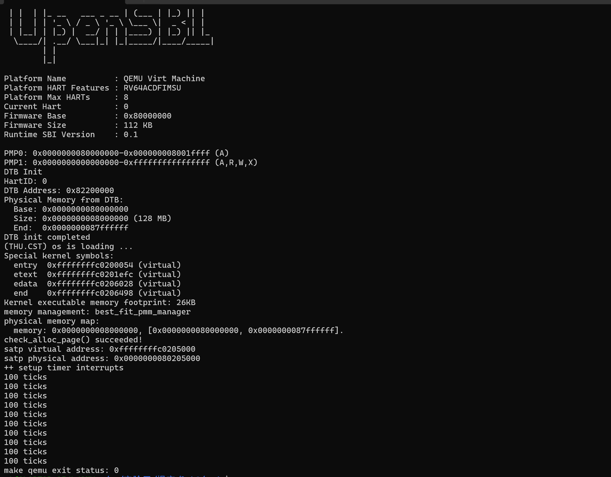
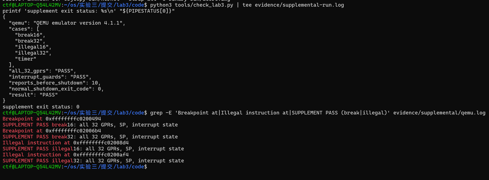
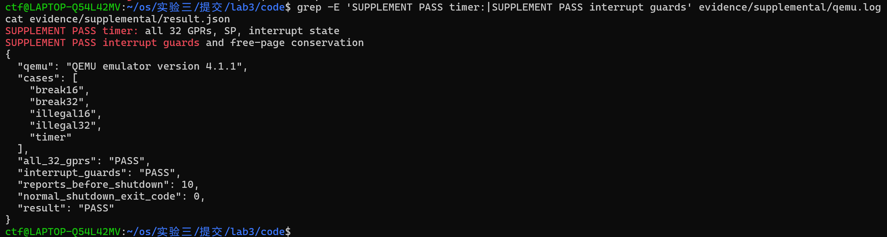

# 操作系统实验报告

## 实验基本信息

| 项目 | 内容 |
| --- | --- |
| **实验名称** | Lab 3：断，都可以断（中断与异常处理） |
| **小组成员** | 2414132-国轩、2411963-孟子玉、2411185-韩东儒 |
| **完成日期** | 2026-11-02 |

### 小组分工

| 成员 | 实验任务 | 报告任务 |
| --- | --- | --- |
| 2414132-国轩 | 衔接实验二的页初始化与 Best-Fit，实现 Trap 上下文恢复及汇编入口，统筹代码整合 | 实验目的、整体逻辑、上下文恢复与入口分析、全文整合 |
| 2411963-孟子玉 | 实现时钟中断、非法指令和断点异常处理，核对 Trap 返回位置 | 中断与异常处理、时钟续设及关机机制、实现问题分析 |
| 2411185-韩东儒 | 分析中断保护接口，整理官方评分及补充测试，核对运行记录 | 实验环境、中断保护、测试与验证 |

实验总结由国轩汇总，孟子玉、韩东儒分别核对中断处理和测试部分。

### 实验文件组织

本实验对应 Git 分支 `lab3`，仓库根目录包含以下两个文件夹：

```text
code/                       实现后的源码、验证脚本及运行日志
report/
├── report.md               实验报告
├── prompt.md               本实验提示词汇总
└── images/                 报告引用的测试截图
```

源码和运行日志分别位于 `code/`、`code/evidence/`，报告、提示词及截图位于 `report/`。

-----

## 一、实验目的

1. 理解 RISC-V 中 Trap、中断和异常的关系，掌握内核识别和分发 Trap 的基本过程。
2. 理解 `stvec`、`sepc`、`scause`、`sstatus` 等寄存器在 Trap 进入与返回时的作用。
3. 根据已有 `SAVE_ALL` 和 `struct trapframe`，实现上下文恢复及汇编入口到 C 语言处理函数的调用。
4. 实现持续的时钟中断处理，以及非法指令、断点异常的识别和返回。
5. 理解保存原中断状态再关闭中断的必要性，并通过实际运行检查寄存器、执行位置和内存分配状态是否正确恢复。

-----

## 二、实验环境

实际验证环境为 Ubuntu 22.04.5 LTS（WSL2，`x86_64`）、`riscv64-unknown-elf-gcc` 15.1.0、QEMU 4.1.1 和 OpenSBI v0.4。QEMU 使用 `virt` 机器，默认内存为 128 MiB，运行单个 hart。

| 项目 | 本次使用情况 |
| --- | --- |
| 实验源码 | `lab3.zip` 提供的实验框架，源码位于 `code/` |
| 编译与链接 | 原工程 Makefile、RISC-V 交叉工具链及链接脚本 |
| 模拟器 | QEMU 4.1.1 |
| 固件 | QEMU 配套的 OpenSBI v0.4，使用 `-bios default` |
| 验证方式 | 内核自检、官方 `make grade`、Python 补充脚本 |

| 成员 | AI 编程工具 | 底层模型 | 备注 |
| --- | --- | --- | --- |
| 2414132-国轩 | Codex（VS Code 插件） | GPT-6 | 辅助分析 Trap frame、实现上下文恢复，整合代码和报告 |
| 2411963-孟子玉 | Claude（VS Code 插件） | DeepSeek-V4-Flash | 辅助实现时钟中断、非法指令与断点异常处理 |
| 2411185-韩东儒 | DeepSeek Harness | DeepSeek-V4-Flash | 辅助分析中断保护，整理补充测试和运行结果 |

启动命令沿用框架的 `-device loader,file=bin/ucore.img,addr=0x80200000`，将内核镜像放入指定物理地址。默认启动日志中可以看到 OpenSBI 版本、设备树内存信息和内核输出。

-----

## 三、实验整体逻辑分析

### 3.1 本章节的逻辑主线

实验一完成了最小内核的启动，实验二建立了物理内存管理。本次实验进一步解决：内核运行过程中发生中断或异常时，怎样暂停原来的执行、处理事件，再回到正确的位置继续运行。

Trap 处理既需要硬件提供入口和状态寄存器，也需要软件保存通用寄存器。处理器进入 S 模式的 Trap 入口时，会记录 `sepc`、`scause` 等状态，并调整 `sstatus` 中的中断使能和来源特权级信息，但不会自动把全部通用寄存器压入内核栈。因此，入口汇编必须先保存执行现场，才能调用可能改写寄存器的 C 函数。

OpenSBI 运行在 M 模式，内核运行在 S 模式。M 模式通过 `mideleg`、`medeleg` 配置中断和异常的委托，受委托的 Trap 交给 S 模式入口处理。内核调用 `sbi_set_timer()` 时，则通过 S 模式的 `ecall` 请求 M 模式固件设置时钟事件。

本次的完整处理链为：

```text
发生 Trap
  → 跳转到 stvec 指向的 __alltraps
  → SAVE_ALL 在当前内核栈上保存 Trap frame
  → 将 Trap frame 地址传给 trap(tf)
  → trap_dispatch() 区分中断和异常
  → 对应 handler 完成处理，必要时调整 tf->epc
  → 返回 __trapret
  → RESTORE_ALL 恢复上下文
  → sret 返回原执行流
```

这里“返回”是否正确，既取决于通用寄存器是否恢复，也取决于 `sepc` 和 `sstatus` 是否正确。时钟中断不应跳过被打断的指令；本实验要求处理后跳过的非法指令和断点指令，则需要根据指令长度更新返回地址。

### 3.2 功能的逐步实现

1. **补齐前序内存管理。** 将实验二的 `page_init()` 和 Best-Fit 管理函数接入本次框架，使内核能够先完成初始化与页分配自检，并保留实验三新加的中断保护。
2. **确定 Trap frame 布局。** 对照 `SAVE_ALL` 和 `struct trapframe`，核对每个通用寄存器及 CSR 对应的栈内偏移，特别是原始 `sp` 的保存位置。
3. **完成入口与恢复。** `__alltraps` 将当前栈顶作为 C 函数参数；`RESTORE_ALL` 从同一 Trap frame 恢复返回状态和通用寄存器，最后交给 `sret`。
4. **实现具体处理。** 持续处理 S 模式时钟中断，识别非法指令和断点异常，并提供其他类型的提示或 Trap frame 输出。
5. **验证返回行为。** 在正常启动后补充不同指令长度、全部整数寄存器、中断状态及正常关机检查。

-----

## 四、实验内容与实现

实验共使用四份提示词，分别用于实验二代码衔接、Trap 入口与上下文恢复、中断与异常处理，以及补充测试，完整内容见 [prompt.md](./prompt.md)。

### 4.1 实验二代码衔接

**负责人：** 2414132-国轩

#### 任务提示词（P1）

```text
[PROMPT]
任务：补齐 code/kern/mm/{pmm.c,best_fit_pmm.c} 的 lab2 位置，接入页初始化与默认 Best-Fit；可复用实验二成果。
操作：修改实际文件，保留本次中断保护、原有测试与公开结构；页初始化署 2414132，Best-Fit 沿用 2411963。
输出：说明迁移点、编译结果和未完成的依赖；只用 QEMU 4.1.1，不改官方测试。

[RELY]
读取同目录 pmm.h、memlayout.h、default_pmm.c，以及 driver/dtb.h、libs/list.h。
DTB 提供内存基址和长度；pages[i] 对应页号 nbase+i，npage 为页号上界。宏以本次工程为准。

[GUARANTEE]
实现 static void page_init(void)，补全 best_fit_pmm_manager 所需接口并选为默认；保留 basic_check、best_fit_check。

[SPECIFICATION]
page_init：Pre 为 DTB 已解析、分配器已初始化；Post 为仅剩余完整空闲页被注册，固件、内核、页描述符和尾部不足一页区域不可分配。
Case：无效基址、零长度、溢出或描述符放不下时 panic；没有完整空闲页时不得调用 init_memmap。管理范围不超过 DTB 与框架上界。
Best-Fit：初始化为空；注册/释放准确计数并合并相邻块；正页数请求选择最小合适块，等大取低地址，恰好分配请求页数。无合适连续块时返回 NULL 且状态不变；零页请求断言拒绝。
Requirements：保持原测试对 free_list、nr_free 的状态约定，不覆盖实验三新增的中断保护与原子位操作。
```

#### Spec 与提示词设计

迁移代码时，我们主要考虑可用页面的范围和分配器状态。规格要求排除已占用区域，明确内存信息无效、描述符空间不足时的处理，并保留原测试使用的 `free_list`、`nr_free`。提示词同时要求保留实验三的中断保护，使迁入的分配器与新框架衔接。

实验三的 `code/kern/mm/pmm.c` 和 `best_fit_pmm.c` 留有实验二代码的补充位置。我们迁入页初始化和 Best-Fit 管理函数，并在 `init_pmm_manager()` 中选择 `best_fit_pmm_manager`。

`page_init()` 仍从设备树取得物理内存范围，在内核末端之后安排页描述符数组，将固件、内核和描述符占用的页面排除，只把剩余完整页面交给分配器。实验三没有定义实验二中的 `PHYSICAL_MEMORY_END`，因此改为从现有布局计算管理上界：

```c
uintptr_t limit = KERNTOP - PHYSICAL_MEMORY_OFFSET;
uintptr_t maxpa = mem_end < limit ? mem_end : limit;
```

当前布局计算出的上界仍为 `0x88000000`。随后再按页向下对齐，避免把不完整尾页纳入管理。

迁移时保留了实验三 `alloc_pages()`、`free_pages()` 和 `nr_free_pages()` 外层的 `local_intr_save()`、`local_intr_restore()`。这些保护属于本次框架新增内容，直接用实验二的整个文件覆盖会丢失它们。Best-Fit 原有的 `basic_check()`、`best_fit_check()` 保持不变。

### 4.2 功能模块一：Trap 上下文恢复与入口

**负责人：** 2414132-国轩

#### 任务提示词（P2）

```text
[PROMPT]
任务：补全 code/kern/trap/trapentry.S 的 lab3 位置，使 Trap 能进入 C 处理函数并恢复返回。
操作：修改实际文件，注释署 2414132；保持 SAVE_ALL、trapframe 布局、trap 签名及官方测试不变。
输出：说明布局对应和返回状态，记录实际编译结果；使用 QEMU 4.1.1，其他模块未完成时如实说明。

[RELY]
读取 trapentry.S、trap.h、trap.c 及 code/libs/riscv.h。SAVE_ALL 是保存布局依据；采用 RISC-V 调用约定及 S 模式 Trap 返回机制。

[GUARANTEE]
实现 RESTORE_ALL；补全 __alltraps 到 void trap(struct trapframe *tf) 的调用；处理后经 __trapret 和 sret 返回。

[SPECIFICATION]
RESTORE_ALL：Pre 为 sp 指向有效 Trap frame；Post 为可写整数寄存器恢复，sepc 使用 tf->epc，sstatus 使用保存的返回状态，sp 回到 Trap 前的值。
__alltraps：Pre 为当前内核栈有效；Post 为 trap 收到正确的 frame 地址，C 函数返回后仍能读取同一 frame 并恢复。
Case：处理函数改写 tf->epc 时，返回到新地址；未改写时保持原执行位置。S 模式 Trap 返回仍为 S 模式，不强制清除 SPP。
Requirements：正确处理 x2 的特殊保存方式、栈对齐和调用造成的寄存器变化；不要求用户栈切换。旧 CSR 名称不兼容时，仅加必要汇编别名，不改 SAVE_ALL。
```

#### Spec 与提示词设计

这一模块的规格从 `SAVE_ALL` 已有的保存方式出发，要求 C 函数收到正确的 Trap frame，返回时恢复整数寄存器、栈指针和返回状态。由于原始 `sp` 经由 `sscratch` 保存，提示词中特别要求核对 x2 对应的槽位，并保持汇编布局与 `struct trapframe` 一致。

主要实现文件为 `code/kern/trap/trapentry.S`，填写 `RESTORE_ALL` 和 `__alltraps` 中的指定位置。已有 `SAVE_ALL`、`struct trapframe` 以及 `trap(struct trapframe *tf)` 的签名均保持不变。

#### Trap 入口初始化

框架的 `idt_init()` 将 `sscratch` 清零，并把 `__alltraps` 的地址写入 `stvec`。入口通过 `.align(2)` 保证 4 字节对齐，地址最低两位为 `00`，对应 Direct 模式：交给 S 模式处理的中断和异常统一从 `__alltraps` 进入，再由 C 函数分发。

这种编码也兼容旧版直接保存 4 字节对齐入口地址的方式：旧地址最低两位原本就是零，在加入模式字段后仍表示 Direct 模式。

`kern_init()` 沿用框架，在 `pmm_init()` 前后调用 `idt_init()`，随后依次执行 `clock_init()`、`intr_enable()`，最后进入主循环。这样，在允许时钟中断响应之前，入口地址和第一个时钟事件都已准备好。

进入 S 模式 Trap 时，硬件将原 `SIE` 保存到 `SPIE`，清除 `SIE`，并在 `SPP` 中记录来源特权级。`SAVE_ALL` 保存的是这时的 `sstatus`，其中 `SPIE` 保留了返回时需要恢复的中断使能状态。

#### Trap frame 的布局

在 RV64 中，`REGBYTES` 为 8。`SAVE_ALL` 在栈上预留 `36 × 8 = 288` 字节，对应 32 个通用寄存器槽位和 4 个 CSR 槽位。

| 内容 | 相对 Trap frame 起点的偏移 | 作用 |
| --- | --- | --- |
| `x0`～`x31` | `0`～`31 × 8` 字节 | 保存通用寄存器，其中 `x2` 槽位保存 Trap 发生前的栈指针 |
| `status` | `32 × 8 = 256` 字节 | 保存 Trap 入口处的 `sstatus` |
| `epc` | `33 × 8 = 264` 字节 | 保存 `sepc`，供处理函数检查或修改返回位置 |
| `badvaddr` | `34 × 8 = 272` 字节 | 保存 `stval`，框架沿用旧名称 |
| `cause` | `35 × 8 = 280` 字节 | 保存 `scause`，用于识别 Trap 类型 |

`sp` 的处理与其他通用寄存器不同。入口先用 `csrw sscratch, sp` 暂存原始栈指针，再下移 `sp` 分配 Trap frame。随后通过 `csrrw s0, sscratch, x0` 取回原始值，并将 `sscratch` 清零，最后把该值写入 `x2` 对应的槽位。因此，x2 槽位保存进入 Trap 前的 `sp`，当前 `sp` 则指向 Trap frame 的起点。

#### 恢复上下文

`RESTORE_ALL` 先读取并恢复 `sstatus`、`sepc`，再恢复通用寄存器。关键顺序如下：

```asm
LOAD s1, 32*REGBYTES(sp)
LOAD s2, 33*REGBYTES(sp)
csrw sstatus, s1
csrw sepc, s2

# 按保存偏移恢复 x1、x3～x31
# ...
LOAD x2, 2*REGBYTES(sp)
```

先使用 `s1`、`s2` 作为临时寄存器写回 CSR，再从 Trap frame 恢复它们原本的值，可以避免恢复后的寄存器被再次覆盖。`x0` 恒为零，无需加载。

`sp` 必须最后恢复，因为前面的加载都依赖当前栈顶作为 Trap frame 的基址。如果提前恢复 `sp`，后续指令就会从错误位置读数据。最后直接读回原始 `sp`，也就回收了当前 Trap frame 所占的栈空间，无需再额外加 288 字节。

`scause` 和 `stval` 的副本供处理函数读取本次 Trap 的原因及附加信息。返回时写回 `sstatus` 和 `sepc`，分别恢复返回状态和执行位置。

#### 汇编入口调用 C 函数

保存现场后，当前 `sp` 就是 `struct trapframe` 的起始地址。按 RISC-V 调用约定，第一个参数放在 `a0`，因此入口补充：

```asm
mv a0, sp
jal trap
```

此时原来的 `a0` 和 `ra` 已保存在 Trap frame 中，设置参数和调用函数不会丢失被打断程序的值。288 字节也是 16 的整数倍，因此在原栈对齐的前提下，调用 C 函数仍满足栈对齐要求。`trap()` 返回时保持调用前的栈位置，接着执行 `__trapret` 中的恢复和 `sret`。

`sret` 根据 `sstatus.SPP` 决定返回特权级，并将 `SPIE` 中保存的中断使能状态恢复到 `SIE`。本实验处理的 Trap 来自内核 S 模式，保存的 `SPP` 为 1，因此 `sret` 返回后继续在 S 模式运行。框架的 `trap_in_kernel(tf)` 也是通过检查保存的 `SPP` 判断 Trap 是否来自内核。

### 4.3 功能模块二：中断与异常处理

**负责人：** 2411963-孟子玉

#### 任务提示词（P3）

```text
[PROMPT]
任务：在 code/kern/trap/trap.c 的 lab3 位置实现中断与异常处理。
操作：修改实际文件，注释署 2411963；保留已有函数和签名，只加必要 include/常量，不改官方测试。
输出：用 QEMU 4.1.1 检查运行行为并记录结果；SHUTDOWN_AFTER 未定义时取 10，并说明这一选择。

[RELY]
读取 trap.h、driver/clock.{c,h}、libs/{riscv.h,sbi.h}。依赖 trapframe、ticks、TICK_NUM、原因宏、clock_set_next_event、print_ticks、print_trapframe、sbi_shutdown。

[GUARANTEE]
实现 void interrupt_handler(struct trapframe *tf) 和 void exception_handler(struct trapframe *tf)。

[SPECIFICATION]
interrupt_handler：Pre 为有效 frame；Post 为按去掉中断标志的原因号分发。每次 IRQ_S_TIMER 都安排后续事件且 ticks 恰增一次，每 TICK_NUM 次打印一次统计，累计 SHUTDOWN_AFTER 次统计后关机；不推进 epc。
Case：U/S/M 的软件、定时器、外部中断输出相应类型提示，S 定时器执行上述逻辑。未知类型打印 Unknown interrupt: cause %lu 并输出 frame；S 软件提示为 Supervisor software interrupt。
exception_handler：Pre 为有效 frame，待跳过的指令位于可读内核映射；非法指令输出 Illegal instruction at 0x%016lx\n，断点输出 Breakpoint at 0x%016lx\n；随后按目标支持的 16/32 位编码推进 epc，返回后不重复执行该指令。
Case：其他异常只输出 frame，不推进 epc，不声称恢复成功。
Requirements：不实现用户态、缺页恢复或设备驱动，不假定所有异常指令都长 4 字节。
```

#### Spec 与提示词设计

时钟中断的规格要求每次续设事件并累计计数，每 100 次输出统计，输出 10 次后关机。异常处理的规格要求输出原因和地址，再按 16 位或 32 位指令长度更新 `epc`。提示词将其他类型的处理约定为输出提示或 Trap frame，便于逐项检查各个分支。

在 `code/kern/trap/trap.c` 的指定位置实现以下两个函数：

```c
void interrupt_handler(struct trapframe *tf);
void exception_handler(struct trapframe *tf);
```

#### Trap 类型识别

框架已有的 `trap_dispatch()` 将 `tf->cause` 转为有符号整数，利用最高位区分中断和异常：最高位为 1 时进入 `interrupt_handler()`，否则进入 `exception_handler()`。

处理中断时，先清除最高位，再根据剩余原因编号进行分发。实现区分用户、监督者和机器级的软件中断、定时器中断和外部中断。除 S 模式时钟中断外，其他已列出的类型输出对应提示；未知类型输出原因编号，并调用 `print_trapframe(tf)` 保存诊断信息。

#### 持续时钟中断

框架的 `clock_init()` 设置 `sie.STIE`，安排第一个时钟事件，将 `ticks` 置零。随后 `intr_enable()` 设置 `sstatus.SIE`，允许 S 模式响应中断。

QEMU 的时间基准为 10 MHz，框架 `timebase` 为 100000，因此每次设置的目标时刻约在当前时间的 10 ms 之后。`clock_set_next_event()` 通过 `sbi_set_timer()` 请求 OpenSBI 设置下一次时钟事件。设置的目标时刻由 `rdtime` 读取的当前时间加上 `timebase` 得到。

S 模式时钟处理的核心代码为：

```c
clock_set_next_event();
++ticks;
if (ticks % TICK_NUM == 0) {
    print_ticks();
    if (ticks / TICK_NUM >= SHUTDOWN_AFTER) {
        sbi_shutdown();
    }
}
```

OpenSBI 每次设置一个时钟事件，因此处理函数在每次触发后续设下一次事件，再累计 `ticks`，形成持续的时钟中断。

`TICK_NUM` 为 100，每累计 100 次中断输出一行 `100 ticks`，全局计数器继续递增。由于下一次事件按处理时的当前时间设置，实际输出间隔还包含中断处理和模拟器运行的延迟。

按照手册的关机要求，我们补充定义 `SHUTDOWN_AFTER` 为 10。第 1000 次时钟中断完成后，内核输出第 10 行统计信息，随后调用 `sbi_shutdown()`。

#### 非法指令与断点异常

对于 `CAUSE_ILLEGAL_INSTRUCTION` 和 `CAUSE_BREAKPOINT`，分别输出：

```text
Illegal instruction at 0x...
Breakpoint at 0x...
```

输出地址来自 `tf->epc`，即触发异常的指令地址。处理完成后，需要跳过本实验约定可忽略的异常指令。如果保持原地址不变，`sret` 会回到同一条指令并再次触发异常。

本实验目标使用 16 位压缩指令和 32 位基本指令。处理函数读取异常指令的第一个 16 位半字，根据最低两位区分长度：

```c
uint16_t instruction = *(volatile const uint16_t *)tf->epc;
tf->epc += (instruction & 3) == 3 ? 4 : 2;
```

在当前目标支持的这两种指令长度中，最低两位为 `11` 时按 4 字节推进，其余按 2 字节推进。读取第一个半字即可区分。

异常测试指令位于可读的内核映射中，处理函数可以直接读取其编码。其他异常调用 `print_trapframe(tf)` 输出现场，并保留原 `epc`。

时钟中断属于异步事件，处理函数不推进 `epc`，返回时继续原执行流；非法指令和断点属于当前指令触发的同步异常，本实验则明确跳过触发指令。这是两种返回位置处理的区别。

### 4.4 中断保护与物理页分配

**负责人：** 2411185-韩东儒

框架在 `code/kern/sync/sync.h` 中提供保存、关闭和恢复中断状态的接口。`__intr_save()` 先检查 `sstatus.SIE`：原来开启时关闭中断并返回真；原来关闭时返回假。`__intr_restore(flag)` 只在保存结果为真时重新开启中断。

因此，内存管理接口的逻辑是“保存状态、关闭中断、访问分配器、恢复原状态”。如果无论进入时是否关闭中断，都在退出时调用 `intr_enable()`，内层操作就可能破坏外层临界区的保护。

嵌套使用时，外层若原来开中断，会保存真并关中断；内层看到中断已关闭，保存假，退出内层后仍保持关闭，直到外层退出才重新开启。补充测试检查了这一行为。

`local_intr_save(x)` 用 `do { ... } while (0)` 包装，使宏在调用处表现为一条完整语句，便于放入 `if/else` 等控制结构，并提供局部语句块。循环条件恒为零，语句块只执行一次。

页描述符的状态位还使用了 `code/libs/atomic.h` 中的位操作。RV64 下，`set_bit()`、`clear_bit()`、`change_bit()` 分别通过 `amoor.d`、`amoand.d`、`amoxor.d` 完成原子的读—改—写，`test_bit()` 用于读取状态位。因此，`SetPageReserved()`、`SetPageProperty()` 等操作保留了实验三的原子位更新方式。

本实验运行单个 hart，关闭本地中断后，页分配器的临界区可以连续执行。多 hart 环境下，共享数据还需要配合锁等同步机制保护。

### 4.5 实现与验证中的问题

**旧 CSR 名称与新版汇编器不兼容。** 首次编译时，汇编器报告 `unknown CSR 'sbadaddr'`。框架沿用旧名称，而该寄存器在当前命名中为 `stval`，编号是 `0x143`。我们在 `code/libs/riscv.h` 中增加仅对汇编生效的 `sbadaddr` 到 `0x143` 的别名，保留了原有 `SAVE_ALL` 的指令和保存布局，再编译通过。

**内存上界宏缺失。** 迁入 `page_init()` 后，编译器指出 `PHYSICAL_MEMORY_END` 未定义。对照实验三的内存布局，改为用 `KERNTOP - PHYSICAL_MEMORY_OFFSET` 计算上界，保持当前管理范围，并保留实验三原有的头文件定义。

**测试文件同名引起目标文件冲突。** 最初将两个临时测试文件都命名为 `supplement`，框架会把它们映射到同一个 `obj/kern/init/supplement.o`，出现规则覆盖、重复定义和缺失汇编符号的链接错误。将汇编文件改名为 `supplement_context.S` 后，两个文件分别生成目标文件，测试才能正常链接运行。

-----

## 五、测试与验证

### 5.1 编译和正常启动

在 `lab3` 分支的仓库根目录执行：

```bash
cd code
qemu-system-riscv64 --version
make
make qemu
```

版本输出为 `QEMU emulator version 4.1.1`，编译成功生成 `bin/kernel` 和 `bin/ucore.img`。[默认启动日志](../code/evidence/qemu-default.log)的关键内容如下：

```text
memory management: best_fit_pmm_manager
physical memory map:
  memory: 0x0000000008000000, [0x0000000080000000, 0x0000000087ffffff].
check_alloc_page() succeeded!
satp virtual address: 0xffffffffc0205000
satp physical address: 0x0000000080205000
++ setup timer interrupts
100 ticks
```

日志中 `100 ticks` 共出现 10 次，之后模拟器结束运行。补充脚本还检查了同样的输出次数和退出码，确认关机路径正常完成。正常内核运行自检与时钟处理；评分和补充测试通过临时副本触发异常。

### 5.2 补充测试

#### 验证提示词（P4）

```text
[PROMPT]
任务：新增 code/tools/check_lab3.py，补查 Trap 返回、中断保护与正常关机。
操作：只在临时源码副本注入探针，不改工作内核或官方工具；保留真实失败信息，不输出虚假 PASS。
输出：提供 --qemu 和 --out 参数，限定 QEMU 4.1.1；在 code/evidence/supplemental 保存构建、运行日志与 JSON 结果。

[RELY]
读取 code/kern/trap/{trap.h,trapentry.S}、driver/clock.h、sync/sync.h、mm/pmm.h、init/init.c 和 Makefile。已有 alloc_page/free_page/nr_free_pages、中断状态接口与 ticks。

[GUARANTEE]
交付可执行的 Python 验证入口；生成必要的 C/汇编探针，退出时回收测试进程与临时目录。

[SPECIFICATION]
Pre：实现已完成，交叉工具链可用；Post：原工作源码不变，结果可由日志核对。
Case 1：实际触发 16/32 位断点和非法指令，检查各自返回；实际等待时钟中断，确认 ticks 增加。
Case 2：用汇编设置/快照整数寄存器，再逐项核对 x0～x31、原 sp/ra/gp/tp、SIE 与 sscratch；探针自身遵守调用约定，比较前不得覆盖待测值。
Case 3：分别在开/关中断时分配、释放页面，检查原中断状态及页数恢复；嵌套保护退出内层后仍关闭，外层退出后恢复。
Case 4：普通时钟路径统计恰有 10 行 100 ticks 并以状态 0 退出；超时、构建失败或断言失败均报告失败。
Requirements：明确写入两种长度的指令编码；失败不得被退出清理掩盖，不以自打印成功信息代替实际断言。
```

#### Spec 与提示词设计

补充测试主要检查返回后的状态。规格要求触发四种异常及一次时钟中断，比较全部整数寄存器和中断状态，再检查页数恢复、嵌套保护和正常关机。提示词要求在临时副本中加入探针，使测试与普通内核分开构建。

#### 测试方法与结果

补充脚本为 `code/tools/check_lab3.py`。它在源码的临时副本中加入测试函数，独立编译并运行。执行方式为：

```bash
python3 tools/check_lab3.py
```

脚本检查 QEMU 版本，并设置运行超时；寄存器比较、输出次数和退出码共同决定测试结果。

| 验证项目 | 实际检查及结果 |
| --- | --- |
| 16 位断点 | 执行编码 `0x9002`，处理后继续运行，寄存器比较通过 |
| 32 位断点 | 执行编码 `0x00100073`，处理后继续运行，寄存器比较通过 |
| 16 位非法指令 | 执行编码 `0x0000`，能够跳过并继续，寄存器比较通过 |
| 32 位非法指令 | 执行当前平台不支持的编码 `0x0000007b`，能够跳过并继续，寄存器比较通过 |
| 真实时钟中断 | 在使能中断后执行 `wfi`，返回后确认 `ticks` 增加，寄存器比较通过 |
| 中断状态 | 上述测试前后的 `SIE` 保持一致，返回后 `sscratch` 为零 |
| 内存接口保护 | 分别在开、关中断状态下分配和释放页面，接口退出后保持原状态，空闲页数恢复 |
| 嵌套保护 | 退出内层保护后保持关中断，退出外层后恢复原状态 |
| 正常关机 | 输出 10 次 `100 ticks` 后结束，QEMU 退出码为 0 |

寄存器检查由汇编和 C 两部分配合完成。测试保留 `ra`、`sp`、`gp`、`tp` 的预期值，给其他可写整数寄存器设置不同的固定值；从 Trap 返回后，先用汇编保存全部 `x0`～`x31`，再交给 C 函数逐项比较。这样可以检查临时寄存器、参数寄存器和保存寄存器，也覆盖栈指针及返回地址。`x0` 的检查对应其恒为零的性质。

四种异常指令通过明确的二进制编码写入，避免汇编器自动压缩使两组测试实际上变成同一种长度。返回后能执行快照和比较，配合各自的通过记录，验证了对应的执行位置推进。

补充运行的输出摘录如下：

```text
SUPPLEMENT PASS break16: all 32 GPRs, SP, interrupt state
SUPPLEMENT PASS break32: all 32 GPRs, SP, interrupt state
SUPPLEMENT PASS illegal16: all 32 GPRs, SP, interrupt state
SUPPLEMENT PASS illegal32: all 32 GPRs, SP, interrupt state
SUPPLEMENT PASS timer: all 32 GPRs, SP, interrupt state
SUPPLEMENT PASS interrupt guards and free-page conservation
```

完整记录见 [补充测试原始输出](../code/evidence/supplemental/qemu.log)和[测试结果汇总](../code/evidence/supplemental/result.json)。测试覆盖整数上下文恢复、单 hart 中断处理和内存接口的状态恢复。

### 5.3 测试截图

正常启动及补充测试结果如下。

**图 1：QEMU 启动、时钟统计与关机。** 正常启动后完成页分配自检，输出 10 行 `100 ticks`，`make qemu` 退出状态为 0。



**图 2：异常指令与寄存器检查。** 16/32 位断点及非法指令均完成处理和返回，四项整数寄存器与中断状态检查通过。



**图 3：时钟、中断保护及关机验证。** 时钟上下文、中断保护和空闲页守恒检查通过；汇总显示 QEMU 4.1.1、10 次统计输出和正常关机退出码 0。




-----

## 六、实验总结与收获

### 对操作系统的理解

| 本实验知识点 | 对应的 OS 原理及联系 |
| --- | --- |
| Trap 的进入与返回 | 处理器记录返回位置和原因，软件保存通用寄存器；二者共同组成可恢复的执行现场 |
| Trap frame 与调用约定 | 栈上的保存布局必须与 C 结构体一致，再通过 `a0` 传参，使汇编入口与 C 处理函数正确衔接 |
| 中断与异常 | 中断是异步事件，异常由当前指令同步触发；本实验分别采用保持返回位置和按指令长度推进的处理方式 |
| `sstatus` 与 `sret` | 保存的 `SPP` 决定返回特权级，`SPIE` 用于恢复中断使能，`sepc` 决定继续执行的位置 |
| 时钟事件续设 | 单次定时服务需要在处理时重新设置，才能形成持续的周期性响应，为后续调度提供基础 |
| 临界区与中断状态保存 | 保存并恢复原中断状态，使页分配器能够在单 hart 上连续修改共享结构，也使内外层保护正确衔接 |

通过这次实验，我们理解了硬件记录 Trap 状态、汇编保存现场和 C 函数处理事件之间的联系。持续的时钟输出验证了多次进入和返回，异常后的寄存器比较则帮助我们检查返回位置、栈指针和其他整数寄存器是否恢复正确。

用户进程、用户态与内核态栈切换、系统调用参数处理、进程调度、缺页异常恢复、外部设备驱动、多核同步及浮点上下文管理，是 OS 原理中的其他重要内容，本实验尚未涉及。

### AI 协作开发的经验

我们先借助 AI 阅读手册和入口代码，再对照 `SAVE_ALL` 检查生成的恢复代码。原始 `sp` 通过 `sscratch` 保存，确认这一关系后，才能正确理解 x2 槽位的值和最后恢复栈指针的顺序。

前序代码迁移也要结合新框架检查。实验三已有中断保护和原子位操作，若直接覆盖整个文件，就可能让新功能丢失。编译中出现的旧 CSR 名称和缺失内存上界宏，则提醒我们：不同实验的结构相近，接口与工具链细节仍可能不同。

验证时，我们先运行正常内核，再用补充测试检查两种长度的异常指令、寄存器恢复及中断状态。这个过程让我们更具体地理解了“能够处理 Trap”和“处理后能够继续执行”之间的联系。

-----

## 参考资料

1. [课程实验指导：实验三练习要求](http://oslab.mobisys.top/lab2026/_book/lab3/lab3_2_1_exercise.html)。
2. [课程实验指导：中断入口点](http://oslab.mobisys.top/lab2026/_book/lab3/lab3_3_2_trapentry.html)。
3. [课程实验指导：中断处理程序](http://oslab.mobisys.top/lab2026/_book/lab3/lab3_3_3_trap.html)。
4. [课程实验指导：时钟中断](http://oslab.mobisys.top/lab2026/_book/lab3/lab3_3_4_clock.html)。
5. [课程实验指导：中断的关闭和开启](http://oslab.mobisys.top/lab2026/_book/lab3/lab3_3_5_atomic.html)。
6. [课程实验指导：RISC-V 中断介绍](http://oslab.mobisys.top/lab2026/_book/lab3/lab3_3_1_introduce.html)。
